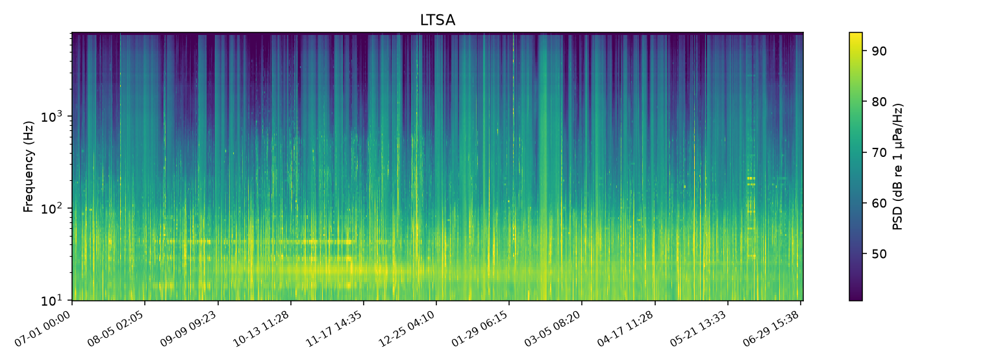
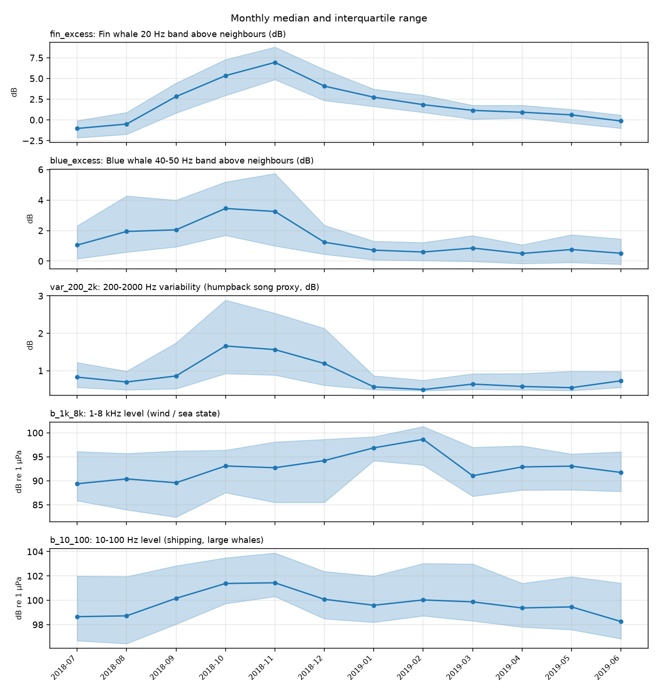
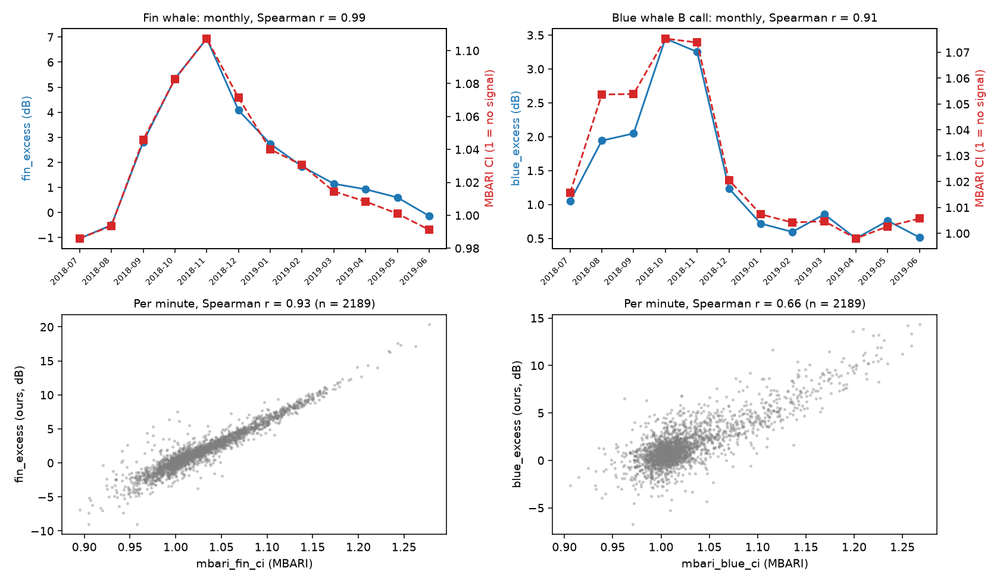
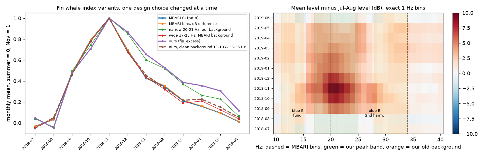

# Ocean Soundscape ML

**Paul Lai** · M.S. Data Science, UC San Diego · [holai@ucsd.edu](mailto:holai@ucsd.edu) · [GitHub](https://github.com/Paul-Lai0111)

Unsupervised discovery of soundscape patterns in a year of deep-ocean hydrophone recordings from
[MBARI's Pacific Sound archive](https://registry.opendata.aws/pacific-sound/) (MARS cabled observatory,
890 m depth, Monterey Bay, California), with every interpretation checked against independent data:
NOAA buoy wind, the USGS earthquake catalog, the hydrophone's laboratory calibration and MBARI's own
published whale call indices.

**Full report:** [English](docs/analysis.md) · [中文](docs/analysis_zh.md) &nbsp;|&nbsp;
**Interactive dashboard:** see [Try it](#try-it)



*One minute per hour, every 4th day, July 2018 to June 2019 (2,189 minutes, calibrated to dB re 1 µPa²/Hz).
The bright band at ~20 Hz from September to January is the fin whale chorus; the thin line at ~45 Hz
from August to November is blue whale B calls; vertical stripes are ships and storms.*

## Try it

The interactive dashboard (Streamlit) shows the year and the November week with named clusters; open
**Inspect a window** to see any minute's spectrogram and **play it** (streamed from MBARI's archive,
optionally sped up 10x so 20 Hz whale calls become audible).

```bash
pip install -r requirements.txt
streamlit run app/dashboard.py
```

It runs from the compact demo data committed in `demo/` (18 MB; built by `scripts/make_demo_data.py`),
so no pipeline run is needed. The same setup deploys as-is to Streamlit Community Cloud
(main file `app/dashboard.py`).

## Key findings

| # | Finding | Evidence |
|---|---|---|
| 1 | **Whale song has a clear season.** Fin whale 20 Hz energy peaks in November, blue whale calls in October-November, humpback song in October-November; all three are near absent in spring-summer. | Monthly medians below; about 50% of minutes in Oct-Nov fall in the "song" cluster vs 0.5-3% in Mar-Aug |
| 2 | **The dominant axis of the raw soundscape is wind, not biology.** 1-8 kHz noise tracks NOAA buoy wind speed (Spearman r = 0.84 for one week, 0.86 for the year). | [Wind validation](#2-wind-explains-the-default-clusters) |
| 3 | **Relative features remove the weather.** Clustering on band-vs-neighbour and within-minute variability features cuts the wind dependence of the clusters from η² = 0.49 to 0.020 and raises silhouette from 0.27 to 0.51. | [Relative features](#3-relative-features-find-the-animals) |
| 4 | **The pipeline found an earthquake on its own.** The loudest minute of the first week is an M3.3 quake 78 km away, arriving ~17 s after origin time. | [Earthquake](#4-an-earthquake-found-without-looking-for-one) |
| 5 | **Our call features agree with MBARI's published call indices, after a flaw the comparison exposed was fixed.** On the same 2,189 minutes they track ours month by month (Spearman r = 0.99 fin, 0.91 blue). The comparison showed our fin whale background bands contained blue whale harmonics; the fixed feature raised per-minute agreement from 0.81 to 0.93. | [MBARI comparison](#6-agreement-with-mbaris-published-call-indices) |
| 6 | **Archive quirks are handled.** Zero-filled recording gaps (22 of 336 minutes in the first week, including a partial 2% gap that would have silently skewed features), 3 missing days, network drops that had silently removed minutes, and suspected instrument transients. | [Data quality](#5-data-quality) |

## Conclusions

1. **The deep-ocean soundscape has a strong biological season**: fin, blue and humpback whale indicators
   rise from September, peak in October-November and fade by January, in step with MBARI's own call
   indices (monthly r = 0.99 fin, 0.91 blue).
2. **Weather dominates the raw sound, so naive clustering finds weather**: noise above 100 Hz follows
   buoy wind (r up to 0.86), and all-feature clusters split calm from windy minutes.
3. **Feature design decides what unsupervised learning finds**: features that compare a band with its
   neighbours or with itself over time cancel the wind (η² 0.020) and separate whale calls, background
   and impulsive events; the measured cost is that ships merge with background.
4. **Independent validation catches what internal metrics miss**: the comparison with MBARI exposed blue
   whale harmonics inside our fin whale feature; ablation located the cause and the fix raised agreement
   from 0.81 to 0.93.
5. **Outliers are worth reading one by one**: one was a real M3.3 earthquake, others suspected
   instrument transients.
6. **Real archives need defensive engineering**: zero-filled gaps, missing days and network drops each
   caused silent errors that were caught only by checking counts after every run.

Not yet established: the humpback cluster is named from spectrograms only, the day/night pattern is a
hint, and everything comes from one year sampled every 4th day.

## What was built

- **A Python pipeline with 8 commands** (`synthetic`, `mbari`, `local`, `list`, `recluster`, `wind`,
  `patterns`, `compare`) that streams minutes from a 4 GB-per-day public archive, extracts 16 acoustic
  features, clusters them and validates the result.
- **Signal processing**: Welch spectra, spectrograms and long-term spectral averages, band levels,
  call-band excess, spectral shape, within-minute variability, kurtosis, calibration to dB re 1 µPa.
- **Machine learning and statistics**: standardization, winsorizing, PCA, K-Means with silhouette,
  ARI on synthetic ground truth, Spearman correlation, η², ablation.
- **Four independent validations**: NOAA wind, USGS earthquakes, MBARI calibration, MBARI call indices
  (re-implemented line by line and cross-checked against MBARI's 2 kHz product to within 0.0006).
- **Engineering**: versioned per-day caching, retries for network errors, gap and short-read detection,
  23 offline tests, and a Streamlit dashboard with audio playback that deploys from `demo/`.
- **A documented history**: each step is one commit, from the first real-data run through the fin
  whale fix (see the [full report](docs/analysis.md), section 2).

## What the pipeline does

```
S3 (daily WAV, 16 kHz, 4.1 GB)  ->  N windows/day          ->  16 features/window    ->  scale -> PCA -> K-Means  ->  figures, dashboard
                                    (byte-range reads,          (band levels, call-band     (k by silhouette;
                                     ~0.2 s per minute)          excess, variability,        optional winsorizing)
                                                                 shape, kurtosis)
                                                                        |
                       NOAA NDBC 46042 wind  ------------------>  validation  <-------  USGS earthquake catalog
```

| Feature | What it captures |
|---|---|
| `b_10_100`, `b_100_1k`, `b_1k_8k` | Broad band levels |
| `fin_17_25`, `blue_40_50`, `hump_200_2k` | Levels in bands used by fin, blue and humpback whales |
| `fin_excess`, `blue_excess` | Call band minus neighbouring bands: narrow-band calls stand out, broadband noise does not |
| `centroid_log10_hz`, `flatness_db`, `low_minus_high_db` | Spectral shape |
| `var_10_100`, `var_200_2k`, `p90_minus_med_200_2k` | How much energy fluctuates within the minute (pulsed calls vs steady noise) |
| `kurtosis` | Impulsiveness of the waveform |

Two feature sets are available. `all` (default) uses all 16 and is best for **noise monitoring** (ships,
sea state). `relative` uses only the six features that compare a band with its neighbours or with itself
over time, so a uniform rise of the noise floor cancels out; it is best for **finding animals**.

## Results

### 1. Seasonal and daily patterns (July 2018 - June 2019)



| Month | fin_excess (dB) | blue_excess (dB) | var_200_2k (dB) | 1-8 kHz (dB re 1 µPa) |
|---|---|---|---|---|
| 2018-07 | -1.0 | 1.1 | 0.83 | 89.4 |
| 2018-08 | -0.5 | 1.9 | 0.70 | 90.4 |
| 2018-09 | 2.8 | 2.1 | 0.86 | 89.6 |
| 2018-10 | 5.3 | **3.5** | **1.66** | 93.1 |
| 2018-11 | **6.9** | 3.3 | 1.56 | 92.7 |
| 2018-12 | 4.1 | 1.2 | 1.19 | 94.2 |
| 2019-01 | 2.7 | 0.7 | 0.57 | 96.9 |
| 2019-02 | 1.8 | 0.6 | 0.50 | **98.6** |
| 2019-03 | 1.2 | 0.9 | 0.64 | 91.1 |
| 2019-04 | 0.9 | 0.5 | 0.58 | 92.9 |
| 2019-05 | 0.6 | 0.8 | 0.55 | 93.1 |
| 2019-06 | -0.1 | 0.5 | 0.73 | 91.7 |

The biological signals rise together in autumn and fade by January, while the wind-driven 1-8 kHz band
peaks in the winter storm months (January-February). These are the expected seasons for the region, but
they are based on one year sampled every 4th day; comparing with published MBARI detections is a next step.


By hour of day (Pacific time, DST-aware), the humpback song proxy is slightly higher at night than during
the day in October-December (+0.6 to +0.95 dB, `diel_night_minus_day.csv`). The effect is small and
based on ~8 days per month, so it is reported as a hint, not a result.

### 2. Wind explains the default clusters

On the first week (2018-11-01..07), default clustering chose k = 2 (silhouette 0.33). The split matched
calm vs windy days. Joining the nearest hourly wind from NOAA buoy 46042 confirmed it:


- 1-8 kHz level vs wind: Spearman r = **0.84** (n = 314); over the full year r = **0.86** (n = 2,171).
- Median wind in the two clusters: **5.1 vs 9.3 m/s**.
- Levels above 100 Hz and spectral shape follow wind (|r| = 0.50-0.84); low-frequency levels, the
  excess features and kurtosis do not (|r| < 0.12); the 200-2000 Hz variability features fall slightly
  with wind (r = -0.36), consistent with wind noise masking short calls.

This is the physics behind wind-driven ambient noise (breaking waves dominate above ~1 kHz), and it
explains why "all features" clusters are weather clusters.

### 3. Relative features find the animals

| Run | Feature set | k (silhouette) | Wind η² of clusters |
|---|---|---|---|
| Nov 2018 week | all | 2 (0.33) | 0.38 |
| Nov 2018 week | relative + winsorize 1% | 4 (0.32) | **0.05** |
| Jul 2018 - Jun 2019 | all | 5 (0.27) | 0.49 |
| Jul 2018 - Jun 2019 | relative + winsorize 1% | 3 (**0.51**) | **0.020** |

*η² = share of wind-speed variance explained by cluster membership (0 = clusters ignore the weather).*


On the November week, the four relative-feature clusters chosen by silhouette are interpretable from the
spectrograms: **background** (162 minutes), **blue whale B calls** (68; blue_excess 10.2 dB vs 3.3-6.2),
**humpback song** (76; 200-2000 Hz variability 3.6 vs 1.2-1.3) and **impulsive transients** (8).
On the year, k = 3 separates background, impulsive events and a "song season" cluster in which fin,
blue and humpback indicators are all elevated.

Winsorizing (clipping each feature to its 1st-99th percentile) matters: without it a single window with
kurtosis 167 took a cluster of its own.

**Trade-off, measured on synthetic data:** relative features recover the three whale classes perfectly
but merge ships with background (adjusted Rand index 0.78 vs 1.0 with all features), because a ship in
the synthetic data is mostly "louder". Use `all` for shipping noise, `relative` for animals.

### 4. An earthquake found without looking for one

The loudest minute of the first week (10-100 Hz at -55 dB re FS, ~30 dB above the median, PC1 = 17 while
every other window is below 8) begins with a sudden low-frequency onset that decays over ~40 s, while
humpback song continues above it. Ships ramp up and down over tens of minutes; this did not.


The USGS catalog lists an **M3.3 earthquake at 16:19:30.5 UTC, 12 km S of Tres Pinos, CA**, about
78 km from MARS. Energy arrives ~17 s after origin time, between the expected P (~13 s) and S (~22 s)
arrivals for that distance.

### 5. Data quality

- **Zero-filled gaps.** MBARI fills recording gaps with exact zeros (about 10 h on 2018-11-07). These
  produced -inf/NaN features and crashed clustering; a window with only 2% zeros would have passed
  silently. Windows with more than 1% exact zeros are now skipped (`RecordingGap`), and any remaining
  non-finite rows are dropped and counted in `summary.json`.
- **Missing days.** 2019-04-05, 2019-04-09 and 2019-06-25 are not in the archive; long runs log and skip
  them instead of aborting.
- **Network drops.** During one re-run an S3 connection failure first aborted the run, and on the retry 19
  of 24 minutes of 2019-03-01 failed one by one and were silently skipped (the day was saved with 5).
  Now a short read raises an error, a failed minute that is not a recording gap makes the whole day
  retry (3 attempts with back-off), an empty window is never mistaken for a gap, and cached days written
  by older code are recomputed. The year was re-run until it reproduced all 2,189 minutes.
- **Suspected instrument transients.** Nine minutes in the year have kurtosis above 600; seven of them
  (kurtosis 665-2036, 10-100 Hz levels up to 155 dB re 1 µPa) form a cluster of their own in the k = 5
  "all features" run. The three inspected are each a single ~30 ms smooth pulse 30-100x the background,
  and none of the seven coincides with a USGS earthquake (M >= 2, 400 km). The cause (mechanical contact
  or electrical) cannot be determined from the audio alone.

### 6. Agreement with MBARI's published call indices

MBARI's Pacific Sound tutorials (J. Ryan) define a **call index** (CI) for fin whales (mean spectrum level
at 20-21 Hz divided by that at 12 and 34 Hz) and for blue whale B calls (43-44 Hz over 37 and 50 Hz), from
calibrated 60 s spectra with 1 Hz resolution; CI = 1 means no signal. MBARI does not publish precomputed
index values, so the pipeline computes the index exactly as in the tutorial code (a test re-implements
it line by line) on the same minutes. As a cross-check, the index from our 16 kHz minutes matches the
index from MBARI's own 2 kHz product to within 0.0006 on three test minutes.



| Agreement (July 2018 - June 2019, n = 2,189) | Fin whale | Blue whale B call |
|---|---|---|
| Monthly (12 months), Spearman r | **0.99** | **0.91** |
| Per minute, whole year | **0.93** | 0.66 |
| Per minute, in season (fin Sep-Jan, blue Aug-Nov) | **0.96** | **0.82** |
| Per minute, out of season | 0.84 | 0.46 |
| Per minute, November 2018 week | **0.97** | **0.89** |

Out of blue whale season the MBARI index barely varies (standard deviation 0.023 vs 0.062 in season), so
there is little signal for the two measures to agree on; in season they agree closely.

**Investigation and fix: blue whale harmonics in the fin whale background.** The first comparison (with
`fin_excess` version 1) agreed less well for fin whales (per minute r = 0.81, monthly 0.95), and from
January to May version 1 declined more slowly than MBARI's index. Exact 1 Hz
spectra of all 2,189 minutes (`scripts/low_freq_spectra.py`) were used to build index variants that
change one design choice at a time (`scripts/fin_index_decomposition.py`). Scaled to summer = 0 and
November = 1, the Jan-May mean is 0.25 for MBARI's index and 0.45 for version 1:

| Variant | Jan-May |
|---|---|
| MBARI index as a dB difference instead of a ratio | 0.25 (no effect) |
| Our wide 17-25 Hz peak band with MBARI's 12 / 34 Hz background | 0.26 (no effect) |
| MBARI's 20-21 Hz peak with our 11-15 / 28-34 Hz background | 0.40 (most of the gap) |
| **Version 2: our 17-25 Hz peak with an 11-13 / 33-36 Hz background** | **0.28** |



The cause is the **background bands**. Version 1's contain the blue whale B call fundamental (~14 Hz) and
second harmonic (~28 Hz). In August-November, the 28 Hz level tracks MBARI's blue whale index
(r = +0.71), and in the 20% of minutes with the strongest blue whale calls version 1 is 0.68 dB
*lower* than in the weakest 20%, although MBARI's fin index shows fin whales are more active then
(1.079 vs 1.030). Blue whale calls raise our "background" and depress the fin whale value in autumn;
in spring the blue whales are gone, so the old index only looked as if it declined slowly.

Version 2 (`FEATURE_VERSION = 2`, used for every number in this README) takes its background from
**11-13 and 33-36 Hz**, which avoid those harmonics. It raises per-minute agreement with MBARI's fin
index from r = 0.81 to 0.93 (0.77 to 0.96 in fin season), monthly agreement from 0.95 to 0.99, and turns
the blue whale effect from -0.68 dB to +3.06 dB. With version 2 the "song season" cluster grows from 257
to 320 minutes (fin whale minutes that blue whale calls had hidden), and in November 24 minutes with
strong blue whale calls move from background into the blue whale cluster. Cached features carry the
version in their file names, so features from version 1 are never reused.

The indices also check the cluster names, without being used to make them:

| Cluster | Minutes | Median fin CI | Median blue CI |
|---|---|---|---|
| Year, relative k=3: "song season" | 320 | **1.091** | **1.050** |
| Year, relative k=3: background | 1,839 | 1.015 | 1.010 |
| Year, relative k=3: impulsive | 30 | 1.000 | 1.005 |
| Nov 2018, relative k=4: "blue whale B calls" | 68 | 1.137 | **1.178** |
| Nov 2018, relative k=4: other three clusters | 8-162 | 1.096-1.128 | 1.068-1.109 |

The cluster named "blue whale B calls" from its spectrograms has the highest MBARI blue whale index of
the week. MBARI has no comparable index for humpback song, so that cluster name rests on spectrograms
(and listening in the dashboard).

## Calibration

`mbari --calibrated` reports absolute levels in **dB re 1 µPa** using MBARI's deployment metadata
(`MBARI_MARS_Hydrophone_Deployment02.json`, referenced in each WAV header): Ocean Sonics icListen HF,
lab-calibrated on 2017-02-02 at **-177.9 dB re V/µPa (250 Hz)** and -176.8 dB (10 kHz), deployed
2017-06-13 to 2024-08-07. Following MBARI's tutorial, float samples are converted to volts with x * 3,
so the offset is 20 log10(3) + 177.9 = **+187.44 dB**. The 250 Hz value is applied at all frequencies
(MBARI also uses it below 250 Hz, where the whale bands are); the measured response varies by 1.1 dB
over the band, so the constant is accurate to about ±0.55 dB. Dates outside the deployment are rejected.
Relative features (excess, variability, shape) do not depend on calibration.

## Quick start

```bash
python -m venv .venv && source .venv/bin/activate
pip install -e ".[dev]"
pytest -q                                          # 23 offline tests, ~25 s

# Offline demo on labelled synthetic sources
python -m oceansound.pipeline synthetic --out outputs/synthetic

# One week of real data (streams ~3 MB per minute from S3, no credentials)
python -m oceansound.pipeline mbari --dates 2018-11-01 2018-11-02 2018-11-03 2018-11-04 2018-11-05 2018-11-06 2018-11-07 --out outputs/mbari_nov2018
python -m oceansound.pipeline wind --out outputs/mbari_nov2018                       # NOAA buoy validation
python -m oceansound.pipeline recluster --src outputs/mbari_nov2018 --out outputs/mbari_nov2018_relative --features relative --clip 0.01

# The year (about 20 minutes): one minute per hour, every 4th day, calibrated
python -m oceansound.pipeline mbari --dates $(cat docs/dates_2018-19.txt) --n-segments 24 --calibrated --out outputs/mbari_2018-19_hourly
python -m oceansound.pipeline patterns --out outputs/mbari_2018-19_hourly            # monthly + hour-of-day
python -m oceansound.pipeline recluster --src outputs/mbari_2018-19_hourly --out outputs/mbari_2018-19_relative --features relative --clip 0.01
python -m oceansound.pipeline compare --out outputs/mbari_2018-19_relative           # vs MBARI call indices
python scripts/figure_earthquake.py                                                  # earthquake figure

# Explore, listen (Inspect tab plays the minute at 1x / 4x / 10x speed) and compare runs
streamlit run app/dashboard.py
```

Each day is cached under `outputs/<run>/cache/`, so re-runs and added days only stream what is new.

### Outputs (per run)

- `features_clustered.csv`: one row per window with features, cluster, PC1-PC3
- `cluster_summary.csv`: feature means per cluster (the cluster "fingerprints")
- `summary.json`: k, silhouette per k, explained variance, feature set, calibration, wind statistics
- `features_wind.csv`, `wind_correlations.csv` (after `wind`)
- `monthly_summary.csv`, `diel_night_minus_day.csv`, `cluster_share_by_month.csv` (after `patterns`)
- `mbari_ci_*.csv` (after `compare`; calibrated runs carry `mbari_fin_ci` / `mbari_blue_ci` columns)
- `figures/`: LTSA, band levels, PCA, silhouette, example spectrograms per cluster, wind, monthly, month x hour

## Validation on synthetic data

Real recordings have no labels, so the code is first checked on synthetic windows with known sources
(ambient noise, ship, fin whale pulses, blue whale B-call-like tonals, humpback-like FM sweeps). With 20
one-minute windows per class, silhouette selects k = 5 and the clusters match the true classes exactly
(ARI = 1.0). This is a sanity check of the code: the synthetic sources are clean and never overlap,
which is why real-data silhouettes are lower (0.27-0.51).


## Limitations and next steps

| Limitation | Status / next step |
|---|---|
| Sampled, not continuous (1 min per hour) | Short events between windows are missed. Rates are comparable across months; for event counts, run with more windows per day on selected days. |
| One year, every 4th day | Enough for a seasonal shape, not for year-to-year change. Extend to 2015-2024 (same calibration from 2017-06). |
| `blue_excess` upper background (55-62 Hz) slightly overlaps the blue whale B call 4th harmonic (r = +0.29 with MBARI's blue index) | Makes `blue_excess` a little less sensitive; it does not mix species (checked like the fin whale fix). Other upper bands are untested. |
| Cluster names come from spectrograms | Fin and blue whale names are now backed by MBARI's call indices; humpback has no MBARI index. Dashboard playback makes listening fast. Next: hand-label a few hundred minutes and train a supervised classifier. |
| Calibration uses one constant | Use the full frequency response from the deployment JSON (±0.55 dB now). |
| Instrument transients are flagged, not explained | Add a QA flag (kurtosis > 100) and ask MBARI about the dates. |

## Author

**Paul Lai** · M.S. Data Science, UC San Diego · [holai@ucsd.edu](mailto:holai@ucsd.edu) · [GitHub](https://github.com/Paul-Lai0111)

Questions, feedback or collaboration ideas are welcome by email.

## Data and credits

- Audio: MBARI Pacific Sound, AWS Open Data: <https://registry.opendata.aws/pacific-sound/>. Please follow
  MBARI's citation terms (the WAV headers cite <https://doi.org/10.1109/OCEANS.2016.7761363>).
- Wind: NOAA National Data Buoy Center, station 46042 (Monterey Bay) historical standard meteorological data.
- Earthquakes: USGS Earthquake Catalog (FDSN event web service).
- Call index method: MBARI Pacific Sound tutorials by John Ryan,
  <https://docs.mbari.org/pacific-sound/> (notebooks: fin whale call index, blue whale B call index).

## Project layout

```
src/oceansound/
  config.py       bands, feature sets, MARS calibration
  data.py         S3 streaming, local WAVs, audio re-read for playback, NOAA download (all network code)
  synthetic.py    labelled synthetic sources for validation
  features.py     PSD, band levels, variability, LTSA + thumbnails, gap detection
  clustering.py   standardize -> (winsorize) -> PCA -> K-Means (silhouette)
  environment.py  NOAA buoy parsing, nearest-time join, wind correlations
  temporal.py     monthly and month x local-hour summaries
  validation.py   agreement with MBARI's call indices
  plots.py        static figures
  pipeline.py     CLI: synthetic | mbari | local | list | recluster | wind | patterns | compare
app/dashboard.py  Streamlit explorer with audio playback (reads demo/ and outputs/)
demo/             compact copies of the year and November runs for the dashboard
scripts/          one-off figures
docs/             figures and the full report (English: docs/analysis.md, Chinese: docs/analysis_zh.md)
tests/            offline tests
```
