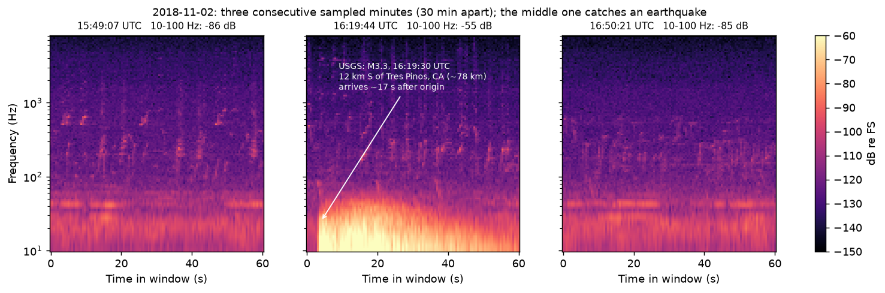
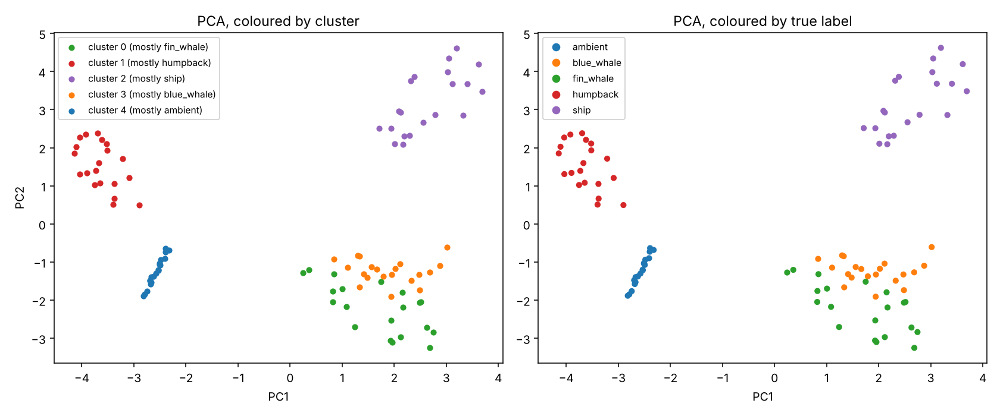

# Ocean Soundscape ML

Unsupervised discovery of soundscape patterns in a year of deep-ocean hydrophone recordings from
[MBARI's Pacific Sound archive](https://registry.opendata.aws/pacific-sound/) (MARS cabled observatory,
890 m depth, Monterey Bay, California), with every interpretation checked against independent data:
NOAA buoy wind, the USGS earthquake catalog, and the hydrophone's laboratory calibration.


*One minute per hour, every 4th day, July 2018 to June 2019 (2,189 minutes, calibrated to dB re 1 µPa²/Hz).
The bright band at ~20 Hz from September to January is the fin whale chorus; the thin line at ~45 Hz
from August to November is blue whale B calls; vertical stripes are ships and storms.*

## Key findings

| # | Finding | Evidence |
|---|---|---|
| 1 | **Whale song has a clear season.** Fin whale 20 Hz energy peaks in November, blue whale calls in October-November, humpback song in October-November; all three are near absent in spring-summer. | Monthly medians below; 37-38% of minutes in Oct-Nov fall in the "song" cluster vs 0.5-3% in Mar-Aug |
| 2 | **The dominant axis of the raw soundscape is wind, not biology.** 1-8 kHz noise tracks NOAA buoy wind speed (Spearman r = 0.84 for one week, 0.86 for the year). | [Wind validation](#2-wind-explains-the-default-clusters) |
| 3 | **Relative features remove the weather.** Clustering on band-vs-neighbour and within-minute variability features cuts the wind dependence of the clusters from η² = 0.49 to 0.025 and raises silhouette from 0.27 to 0.52. | [Relative features](#3-relative-features-find-the-animals) |
| 4 | **The pipeline found an earthquake on its own.** The loudest minute of the first week is an M3.3 quake 78 km away, arriving ~17 s after origin time. | [Earthquake](#4-an-earthquake-found-without-looking-for-one) |
| 5 | **Archive quirks are handled.** Zero-filled recording gaps (22 of 336 minutes in the first week, including a partial 2% gap that would have silently skewed features), 3 missing days, and 7 suspected instrument transients. | [Data quality](#5-data-quality) |

## What the pipeline does

```
S3 (daily WAV, 16 kHz, 4.1 GB)  ->  N windows/day          ->  16 features/window    ->  scale -> PCA -> K-Means  ->  figures, dashboard
                                    (byte-range reads,          (band levels, call-band     (k by silhouette;
                                     ~0.2 s per minute)          excess, variability,        optional winsorizing)
                                                                 shape, kurtosis)
                                                                        |
                       NOAA NDBC 46042 wind  ------------------>  validation  <-------  USGS earthquake catalog
```

| Feature | What it captures |
|---|---|
| `b_10_100`, `b_100_1k`, `b_1k_8k` | Broad band levels |
| `fin_17_25`, `blue_40_50`, `hump_200_2k` | Levels in bands used by fin, blue and humpback whales |
| `fin_excess`, `blue_excess` | Call band minus neighbouring bands: narrow-band calls stand out, broadband noise does not |
| `centroid_log10_hz`, `flatness_db`, `low_minus_high_db` | Spectral shape |
| `var_10_100`, `var_200_2k`, `p90_minus_med_200_2k` | How much energy fluctuates within the minute (pulsed calls vs steady noise) |
| `kurtosis` | Impulsiveness of the waveform |

Two feature sets are available. `all` (default) uses all 16 and is best for **noise monitoring** (ships,
sea state). `relative` uses only the six features that compare a band with its neighbours or with itself
over time, so a uniform rise of the noise floor cancels out; it is best for **finding animals**.

## Results

### 1. Seasonal and daily patterns (July 2018 - June 2019)


| Month | fin_excess (dB) | blue_excess (dB) | var_200_2k (dB) | 1-8 kHz (dB re 1 µPa) |
|---|---|---|---|---|
| 2018-07 | -1.0 | 1.1 | 0.83 | 89.4 |
| 2018-08 | -1.4 | 1.9 | 0.70 | 90.4 |
| 2018-09 | 1.7 | 2.1 | 0.86 | 89.6 |
| 2018-10 | 2.9 | **3.5** | **1.66** | 93.1 |
| 2018-11 | **4.6** | 3.3 | 1.56 | 92.7 |
| 2018-12 | 3.5 | 1.2 | 1.19 | 94.2 |
| 2019-01 | 2.5 | 0.7 | 0.57 | 96.9 |
| 2019-02 | 1.8 | 0.6 | 0.50 | **98.6** |
| 2019-03 | 1.0 | 0.9 | 0.64 | 91.1 |
| 2019-04 | 0.8 | 0.5 | 0.58 | 92.9 |
| 2019-05 | 0.6 | 0.8 | 0.55 | 93.1 |
| 2019-06 | -0.4 | 0.5 | 0.73 | 91.7 |

The biological signals rise together in autumn and fade by January, while the wind-driven 1-8 kHz band
peaks in the winter storm months (January-February). These are the expected seasons for the region, but
they are based on one year sampled every 4th day; comparing with published MBARI detections is a next step.


By hour of day (Pacific time, DST-aware), the humpback song proxy is slightly higher at night than during
the day in October-December (+0.6 to +0.95 dB, `diel_night_minus_day.csv`). The effect is small and
based on ~8 days per month, so it is reported as a hint, not a result.

### 2. Wind explains the default clusters

On the first week (2018-11-01..07), default clustering chose k = 2 (silhouette 0.34). The split matched
calm vs windy days. Joining the nearest hourly wind from NOAA buoy 46042 confirmed it:


- 1-8 kHz level vs wind: Spearman r = **0.84** (n = 314); over the full year r = **0.86** (n = 2,171).
- Median wind in the two clusters: **5.0 vs 9.3 m/s**.
- Levels above 100 Hz and spectral shape follow wind (|r| = 0.50-0.84); low-frequency levels, the
  excess features and kurtosis do not (|r| < 0.12); the 200-2000 Hz variability features fall slightly
  with wind (r = -0.36), consistent with wind noise masking short calls.

This is the physics behind wind-driven ambient noise (breaking waves dominate above ~1 kHz), and it
explains why "all features" clusters are weather clusters.

### 3. Relative features find the animals

| Run | Feature set | k (silhouette) | Wind η² of clusters |
|---|---|---|---|
| Nov 2018 week | all | 2 (0.34) | 0.38 |
| Nov 2018 week | relative + winsorize 1% | 4 (0.33) | **0.06** |
| Jul 2018 - Jun 2019 | all | 5 (0.27) | 0.49 |
| Jul 2018 - Jun 2019 | relative + winsorize 1% | 3 (**0.52**) | **0.025** |

*η² = share of wind-speed variance explained by cluster membership (0 = clusters ignore the weather).*


On the November week, the four relative-feature clusters chosen by silhouette are interpretable from the
spectrograms: **background** (185 minutes), **blue whale B calls** (45; blue_excess 11.6 dB vs 3.9),
**humpback song** (76; 200-2000 Hz variability 3.7 vs 1.3) and **impulsive transients** (8).
On the year, k = 3 separates background, impulsive events and a "song season" cluster in which fin,
blue and humpback indicators are all elevated.

Winsorizing (clipping each feature to its 1st-99th percentile) matters: without it a single window with
kurtosis 167 took a cluster of its own.

**Trade-off, measured on synthetic data:** relative features recover the three whale classes perfectly
but merge ships with background (adjusted Rand index 0.78 vs 1.0 with all features), because a ship in
the synthetic data is mostly "louder". Use `all` for shipping noise, `relative` for animals.

### 4. An earthquake found without looking for one

The loudest minute of the first week (10-100 Hz at -55 dB re FS, ~30 dB above the median, PC1 = 17 while
every other window is below 8) begins with a sudden low-frequency onset that decays over ~40 s, while
humpback song continues above it. Ships ramp up and down over tens of minutes; this did not.



The USGS catalog lists an **M3.3 earthquake at 16:19:30.5 UTC, 12 km S of Tres Pinos, CA**, about
78 km from MARS. Energy arrives ~17 s after origin time, between the expected P (~13 s) and S (~22 s)
arrivals for that distance.

### 5. Data quality

- **Zero-filled gaps.** MBARI fills recording gaps with exact zeros (about 10 h on 2018-11-07). These
  produced -inf/NaN features and crashed clustering; a window with only 2% zeros would have passed
  silently. Windows with more than 1% exact zeros are now skipped (`RecordingGap`), and any remaining
  non-finite rows are dropped and counted in `summary.json`.
- **Missing days.** 2019-04-05, 2019-04-09 and 2019-06-25 are not in the archive; long runs log and skip
  them instead of aborting.
- **Suspected instrument transients.** Seven minutes in the year have kurtosis 600-2000 and broadband
  levels up to 155 dB re 1 µPa in 10-100 Hz. The three inspected are each a single ~30 ms smooth pulse
  30-100x the background; none of the seven coincides with a USGS earthquake (M >= 2, 400 km), and they cluster together (k = 5, "all" run).
  The cause (mechanical contact or electrical) cannot be determined from the audio alone.

## Calibration

`mbari --calibrated` reports absolute levels in **dB re 1 µPa** using MBARI's deployment metadata
(`MBARI_MARS_Hydrophone_Deployment02.json`, referenced in each WAV header): Ocean Sonics icListen HF,
lab-calibrated on 2017-02-02 at **-177.9 dB re V/µPa (250 Hz)** and -176.8 dB (10 kHz), deployed
2017-06-13 to 2024-08-07. Following MBARI's tutorial, float samples are converted to volts with x * 3,
so the offset is 20 log10(3) + 177.9 = **+187.44 dB**. The 250 Hz value is applied at all frequencies
(MBARI also uses it below 250 Hz, where the whale bands are); the measured response varies by 1.1 dB
over the band, so the constant is accurate to about ±0.55 dB. Dates outside the deployment are rejected.
Relative features (excess, variability, shape) do not depend on calibration.

## Quick start

```bash
python -m venv .venv && source .venv/bin/activate
pip install -e ".[dev]"
pytest -q                                          # 13 offline tests, ~20 s

# Offline demo on labelled synthetic sources
python -m oceansound.pipeline synthetic --out outputs/synthetic

# One week of real data (streams ~3 MB per minute from S3, no credentials)
python -m oceansound.pipeline mbari --dates 2018-11-01 2018-11-02 2018-11-03 2018-11-04 2018-11-05 2018-11-06 2018-11-07 --out outputs/mbari_nov2018
python -m oceansound.pipeline wind --out outputs/mbari_nov2018                       # NOAA buoy validation
python -m oceansound.pipeline recluster --src outputs/mbari_nov2018 --out outputs/mbari_nov2018_relative --features relative --clip 0.01

# The year (about 20 minutes): one minute per hour, every 4th day, calibrated
python -m oceansound.pipeline mbari --dates $(cat docs/dates_2018-19.txt) --n-segments 24 --calibrated --out outputs/mbari_2018-19_hourly
python -m oceansound.pipeline patterns --out outputs/mbari_2018-19_hourly            # monthly + hour-of-day
python scripts/figure_earthquake.py                                                  # earthquake figure

# Explore, listen (Inspect tab plays the minute at 1x / 4x / 10x speed) and compare runs
streamlit run app/dashboard.py
```

Each day is cached under `outputs/<run>/cache/`, so re-runs and added days only stream what is new.

### Outputs (per run)

- `features_clustered.csv`: one row per window with features, cluster, PC1-PC3
- `cluster_summary.csv`: feature means per cluster (the cluster "fingerprints")
- `summary.json`: k, silhouette per k, explained variance, feature set, calibration, wind statistics
- `features_wind.csv`, `wind_correlations.csv` (after `wind`)
- `monthly_summary.csv`, `diel_night_minus_day.csv`, `cluster_share_by_month.csv` (after `patterns`)
- `figures/`: LTSA, band levels, PCA, silhouette, example spectrograms per cluster, wind, monthly, month x hour

## Validation on synthetic data

Real recordings have no labels, so the code is first checked on synthetic windows with known sources
(ambient noise, ship, fin whale pulses, blue whale B-call-like tonals, humpback-like FM sweeps). With 20
one-minute windows per class, silhouette selects k = 5 and the clusters match the true classes exactly
(ARI = 1.0). This is a sanity check of the code: the synthetic sources are clean and never overlap,
which is why real-data silhouettes are lower (0.27-0.52).



## Limitations and next steps

| Limitation | Status / next step |
|---|---|
| Sampled, not continuous (1 min per hour) | Short events between windows are missed. Rates are comparable across months; for event counts, run with more windows per day on selected days. |
| One year, every 4th day | Enough for a seasonal shape, not for year-to-year change. Extend to 2015-2024 (same calibration from 2017-06). |
| Cluster names come from spectrograms | Dashboard playback makes listening fast. Next: hand-label a few hundred minutes and train a supervised classifier; compare with MBARI's published fin/blue whale call indices. |
| Calibration uses one constant | Use the full frequency response from the deployment JSON (±0.55 dB now). |
| Instrument transients are flagged, not explained | Add a QA flag (kurtosis > 100) and ask MBARI about the dates. |

## Data and credits

- Audio: MBARI Pacific Sound, AWS Open Data: <https://registry.opendata.aws/pacific-sound/>. Please follow
  MBARI's citation terms (the WAV headers cite <https://doi.org/10.1109/OCEANS.2016.7761363>).
- Wind: NOAA National Data Buoy Center, station 46042 (Monterey Bay) historical standard meteorological data.
- Earthquakes: USGS Earthquake Catalog (FDSN event web service).

## Project layout

```
src/oceansound/
  config.py       bands, feature sets, MARS calibration
  data.py         S3 streaming, local WAVs, audio re-read for playback, NOAA download (all network code)
  synthetic.py    labelled synthetic sources for validation
  features.py     PSD, band levels, variability, LTSA + thumbnails, gap detection
  clustering.py   standardize -> (winsorize) -> PCA -> K-Means (silhouette)
  environment.py  NOAA buoy parsing, nearest-time join, wind correlations
  temporal.py     monthly and month x local-hour summaries
  plots.py        static figures
  pipeline.py     CLI: synthetic | mbari | local | list | recluster | wind | patterns
app/dashboard.py  Streamlit explorer with audio playback
scripts/          one-off figures
docs/             figures and the analysis write-up (Chinese: docs/analysis_zh.md)
tests/            offline tests
```
