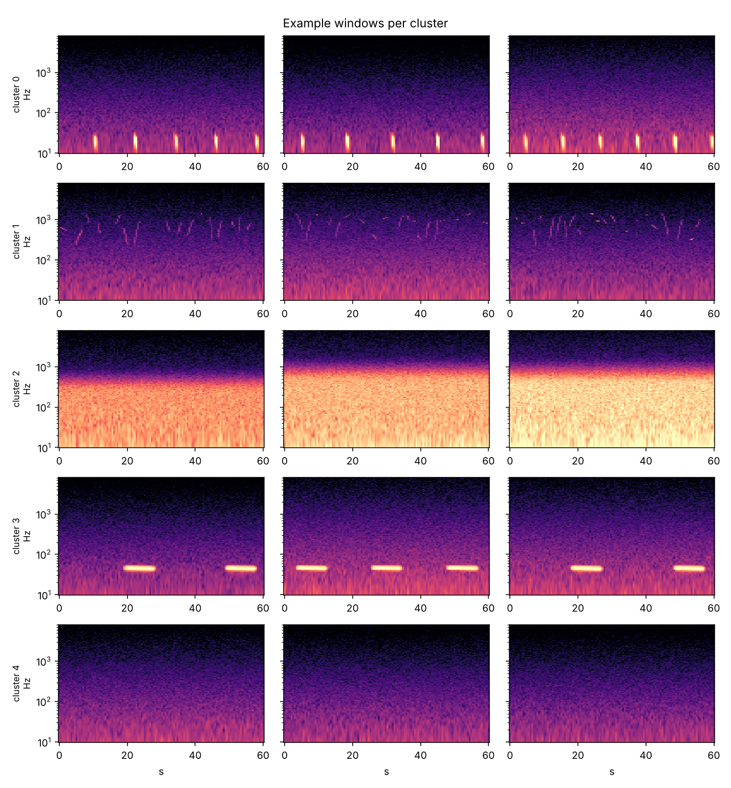
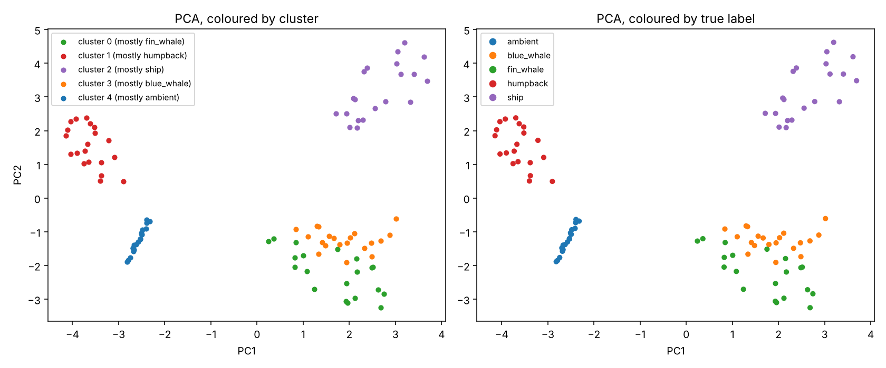

# Ocean Soundscape ML

Unsupervised discovery of soundscape patterns in deep-ocean hydrophone recordings from
[MBARI's Pacific Sound archive](https://registry.opendata.aws/pacific-sound/) (MARS cabled
observatory, ~900 m depth, Monterey Bay, California).

The pipeline streams one-minute windows directly from the public S3 archive (no full-day downloads),
computes acoustic features aimed at known sound sources (shipping, fin whales, blue whales, humpback
whales), groups windows into soundscape classes with PCA + K-Means, and serves the results in an
interactive dashboard.



## Why

Passive acoustic monitoring produces months of continuous audio per hydrophone, far more than anyone
can listen to. A first step in any soundscape study is to summarize that audio (long-term spectral
averages, band levels) and to find recurring patterns: when ships pass, when whales call, how the
noise floor changes with weather and season. This project builds that first step as a reproducible
pipeline.

## What it does

```
S3 (daily WAV, 16 kHz)  ->  N evenly spaced windows/day  ->  features per window  ->  PCA + K-Means  ->  figures + dashboard
                                (byte-range reads)          (PSD, band levels,       (k chosen by
                                                             excess, variability)     silhouette)
```

| Feature | What it captures |
|---|---|
| `b_10_100`, `b_100_1k`, `b_1k_8k` | Broad band levels (dB) |
| `fin_17_25`, `blue_40_50`, `hump_200_2k` | Levels in bands used by fin, blue and humpback whales |
| `fin_excess`, `blue_excess` | Call band minus neighbouring bands: narrow-band calls stand out, broadband noise does not |
| `centroid_log10_hz`, `flatness_db`, `low_minus_high_db` | Spectral shape |
| `var_10_100`, `var_200_2k`, `p90_minus_med_200_2k` | How much energy fluctuates within the minute (pulsed calls vs steady noise) |
| `kurtosis` | Impulsiveness of the waveform |

## Validation on synthetic data

Real recordings have no labels, so the pipeline is first checked on synthetic windows with known
sources (ambient noise, ship, fin whale pulses, blue whale B-call-like tonals, humpback-like FM sweeps).
With 20 one-minute windows per class, silhouette selection picks k = 5 and the clusters match the true
classes exactly (adjusted Rand index = 1.0).

This is a sanity check of the code, not evidence about real data: the synthetic sources are clean
caricatures and never overlap. Real windows mix sources, so expect fuzzier clusters.



## Quick start

```bash
python -m venv .venv && source .venv/bin/activate
pip install -e ".[dev]"

# 1. Offline demo (about 30 s)
python -m oceansound.pipeline synthetic --out outputs/synthetic
pytest -q

# 2. Real data: which days exist?
python -m oceansound.pipeline list --year 2018 --month 11

# 3. Real data: 48 one-minute windows per day, three days
python -m oceansound.pipeline mbari --dates 2018-11-01 2018-11-02 2018-11-03 --out outputs/mbari_nov2018

# 4. Explore
streamlit run app/dashboard.py
```

Each day is cached under `outputs/<run>/cache/`, so adding a day only streams the new one.
`recluster --out <run> --k 6` re-runs clustering with a fixed k without touching the network.

### Outputs (per run)

- `features_clustered.csv`: one row per window with features, cluster, PC1-PC3
- `cluster_summary.csv`: feature means per cluster (the cluster "fingerprints")
- `pca_loadings.csv`, `summary.json` (k, silhouette per k, explained variance)
- `figures/`: LTSA, band levels, PCA, silhouette, example spectrograms per cluster

## Calibration

Levels are reported in **dB relative to digital full scale** by default. To convert to absolute sound
pressure levels (dB re 1 µPa²/Hz) you need the hydrophone sensitivity and recorder gain for the
period analysed, from MBARI's documentation for the dataset. Pass the combined offset with
`--calibration-db`. Relative features (`*_excess`, variability, shape) do not depend on calibration.

## Limitations and next steps

- Windows are sampled (e.g. 1 min every 30 min), not continuous: short events between windows are missed.
- Clusters are unsupervised and need to be checked by listening and looking at spectrograms before being
  given names.
- Next: compare against published detections, add a supervised call detector, examine seasonal and
  diel (day/night) patterns over months, and add audio playback to the dashboard.

## Data

MBARI Pacific Sound, hosted by the AWS Open Data program: <https://registry.opendata.aws/pacific-sound/>.
Please follow MBARI's citation and usage terms listed there.

## Project layout

```
src/oceansound/
  config.py      bands and defaults
  data.py        S3 streaming + local WAV reading
  synthetic.py   labelled synthetic sources for validation
  features.py    PSD, band levels, variability, LTSA + thumbnails
  clustering.py  standardize -> PCA -> K-Means (silhouette)
  plots.py       static figures
  pipeline.py    CLI
app/dashboard.py Streamlit explorer
tests/           offline tests
```
