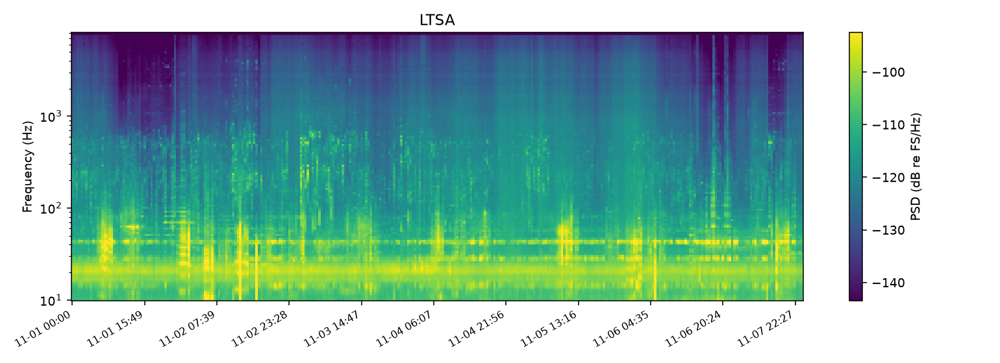
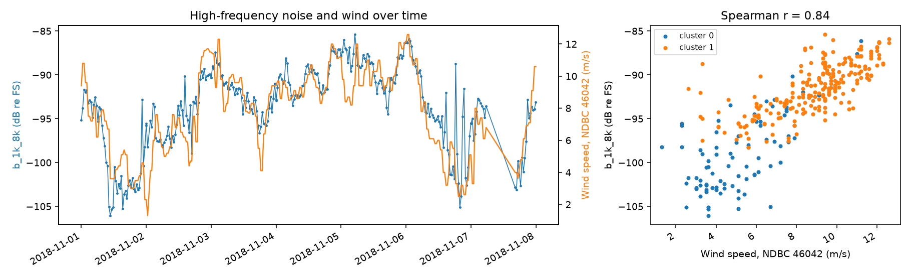
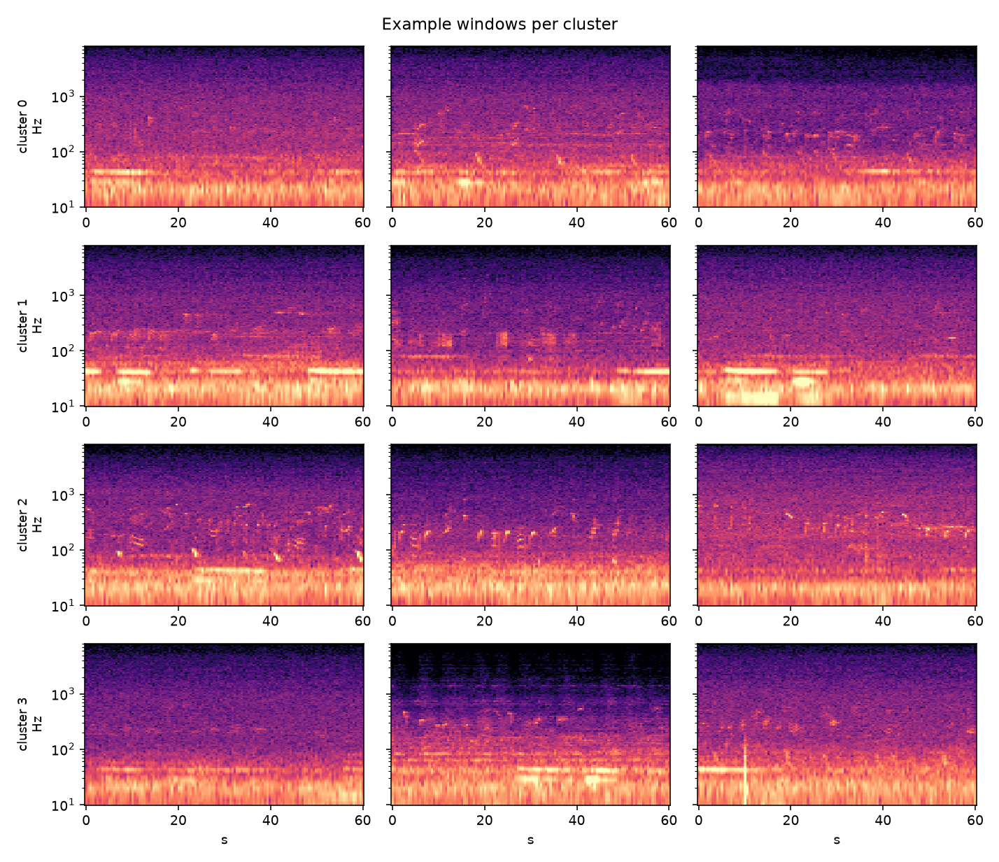
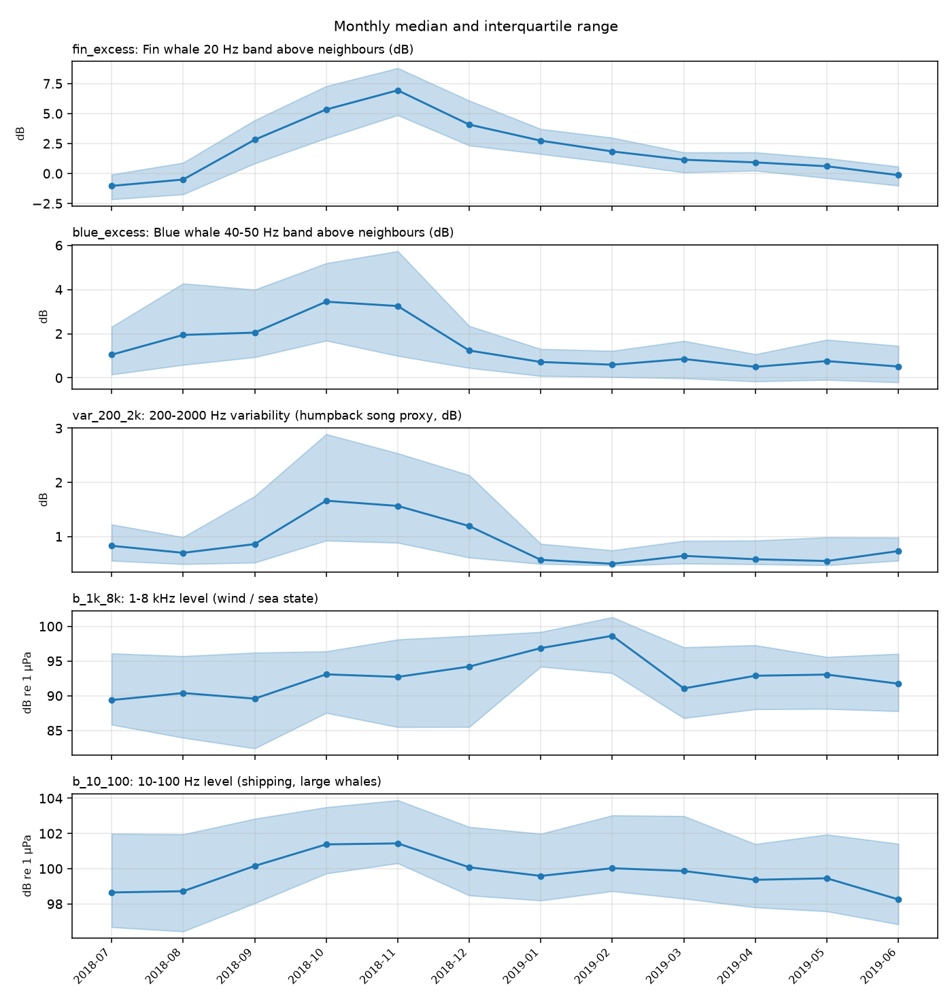
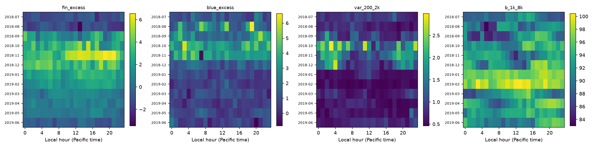
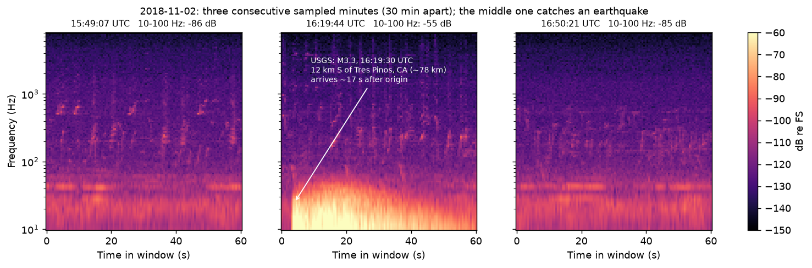
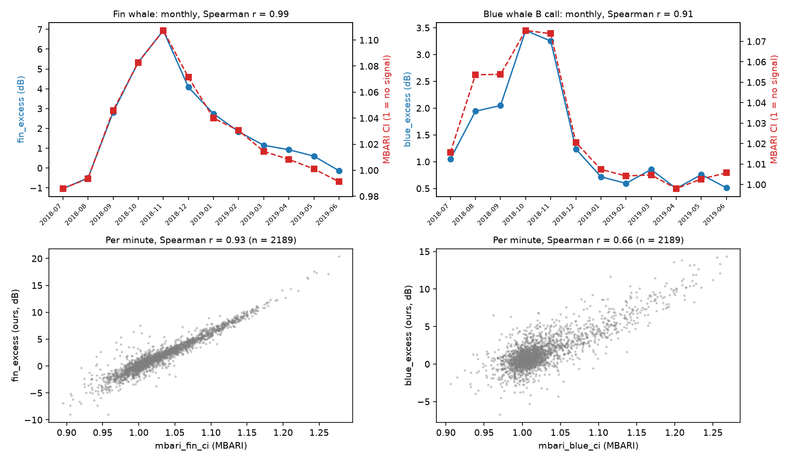
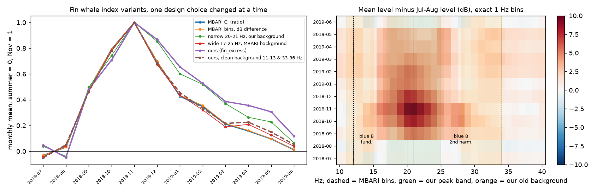

# Deep-Ocean Soundscape Analysis: Full Report

**Paul Lai** · M.S. Data Science, UC San Diego · [holai@ucsd.edu](mailto:holai@ucsd.edu) · [GitHub](https://github.com/Paul-Lai0111)

MBARI MARS cabled observatory hydrophone (Monterey Bay, California, 890 m depth).
Data: July 2018 - June 2019 (the year) and 1-7 November 2018 (the first week, examined in detail).

> This is the complete record of the analysis, including what went wrong and how it was fixed.
> The [README](../README.md) is the short version; a Chinese translation is in
> [analysis_zh.md](analysis_zh.md). Every number here can be reproduced with the commands in the
> README "Quick start". Interactive version: `streamlit run app/dashboard.py`.

---

## 0. Summary

| # | Finding | Evidence |
|---|---|---|
| 1 | **Whale song has a clear season.** Fin whales peak in November; blue whales and humpbacks in October-November; all three are nearly absent in spring and summer. | Monthly medians; about 50% of minutes in Oct-Nov fall in the "song season" cluster vs 0.5-3% in Mar-Aug |
| 2 | **The dominant source of variation in the raw soundscape is wind, not animals.** | 1-8 kHz noise vs NOAA buoy wind: Spearman r = 0.84 (one week), 0.86 (year) |
| 3 | **"Relative" features stop the clustering from following the weather.** | Wind η² of clusters 0.49 -> 0.020; silhouette 0.27 -> 0.51 |
| 4 | **The pipeline found an earthquake on its own.** | The week's largest outlier is an M3.3 quake 78 km away (USGS); arrival time matches |
| 5 | **Comparing with MBARI's published call indices exposed, and led to fixing, a flaw in our own feature.** | Blue whale harmonics in the fin whale background bands; after the fix, agreement per minute 0.81 -> 0.93 and per month 0.95 -> 0.99 (blue whale per month 0.91) |
| 6 | **Data-quality problems were found and handled.** | Zero-filled recording gaps, missing days, network drops that silently lost data, suspected instrument transients |

---

## 1. Conclusions

1. **The MARS soundscape has a strong, repeatable biological season.** Fin whale, blue whale and
   humpback indicators rise from September, peak in October-November and fall away by January. The
   timing agrees with MBARI's own call indices computed on the same minutes (monthly r = 0.99 for
   fin whales and 0.91 for blue whales), so it is not an artifact of our features.
2. **Weather dominates the raw sound, so naive clustering finds weather.** Clustering on all 16
   features splits minutes into calm and windy (median wind 5.1 vs 9.3 m/s), because noise above
   100 Hz rises with wind (r up to 0.86). This is the known physics of breaking-wave noise, measured
   here directly against a buoy.
3. **Feature design decides what unsupervised learning finds.** Using only features that compare a
   band with its own neighbours or with itself over time cancels the wind (η² 0.020) and lets the
   clusters separate blue whale calls, humpback song, background and impulsive events. The trade-off
   was measured: these features ignore loudness, so they merge ships with background. Use `all` for
   noise and shipping, `relative` for animals.
4. **Independent validation catches errors that internal metrics cannot.** Silhouette scores looked
   reasonable throughout, yet comparison with MBARI's index revealed that blue whale harmonics were
   depressing our fin whale feature in autumn. Changing one design choice at a time located the cause
   exactly, and the fix raised agreement from 0.81 to 0.93 without changing the main conclusions.
5. **Unsupervised outliers are worth investigating.** The largest outlier of the first week was a
   real M3.3 earthquake; other extreme outliers were suspected instrument transients. Both would be
   missed or misread without looking at them individually.
6. **Long-running pipelines on real archives need defensive engineering.** Zero-filled gaps, missing
   days and network drops each produced wrong or missing results silently, and were only caught
   because counts and summaries were checked after every run.

What is **not** yet established: the humpback cluster is named from spectrograms only (MBARI has no
comparable index), the day/night pattern is a hint, and all results come from one year sampled every
4th day.

---

## 2. What was built

**Pipeline** (`src/oceansound/`, a Python package with a command-line interface)

| Command | What it does |
|---|---|
| `synthetic` | Generates labelled synthetic sounds (ambient, ship, fin, blue, humpback) and checks the method recovers them |
| `mbari` | Streams sampled minutes from MBARI's S3 archive, extracts features, clusters; optional calibration |
| `local`, `list` | Same for local WAV files; list the archive's days |
| `recluster` | Re-clusters saved features with another feature set, k or winsorizing, without downloading |
| `wind` | Joins NOAA buoy 46042 hourly wind and tests the sea-state interpretation |
| `patterns` | Monthly and month x local-hour (Pacific time, DST-aware) summaries |
| `compare` | Computes MBARI's fin and blue whale call indices and measures agreement |

**Signal processing**: Welch power spectra (1 Hz), spectrograms and long-term spectral averages,
band levels, call-band "excess" over neighbouring bands, spectral flatness and centroid, within-minute
variability, kurtosis, calibration to dB re 1 µPa.

**Machine learning and statistics**: standardization, winsorizing, PCA, K-Means with k chosen by
silhouette, adjusted Rand index (synthetic ground truth), Spearman correlation, η² (variance of wind
explained by clusters), ablation (one design choice changed at a time).

**Validation against four independent sources**: NOAA NDBC buoy 46042 (wind), USGS earthquake catalog,
MBARI's hydrophone calibration file, MBARI's published call-index method (re-implemented line by line
and cross-checked against MBARI's own 2 kHz data product to within 0.0006).

**Engineering**: byte-range streaming from a 4 GB-per-day public archive (0.2 s per minute), per-day
caching keyed by calibration and feature version, retries for network errors, detection of
zero-filled gaps and short reads, 23 offline tests (pytest), and a Streamlit dashboard that shows any
minute's spectrogram and plays its audio (streamed from the archive, optionally sped up 10x so 20 Hz
calls become audible), deployable from the compact data in `demo/`.

**Project history** (one commit per step):

| Step | Work | Outcome |
|---|---|---|
| 1 | First real-data run | Archive layout confirmed; zero-filled gaps crashed clustering -> gap detection |
| 2 | First week analysed | Default clusters = weather; earthquake found |
| 3 | Limitations addressed | Wind validation, relative features + winsorizing, audio playback, calibration, a full year |
| 4 | Comparison with MBARI | Call indices re-implemented; network drop that silently lost 19 minutes fixed |
| 5 | Fin whale investigation | Ablation traced a gap to blue whale harmonics in our background bands |
| 6 | Feature version 2 | Fix adopted, everything re-run, every number updated |
| 7 | Demo | Compact demo data, named clusters, deployable dashboard |

---

## 3. Data and methods

| Item | Detail |
|---|---|
| Source | MBARI Pacific Sound, `s3://pacific-sound-16khz/` (AWS Open Data, anonymous access) |
| Files (measured) | One WAV per day, ~4.15 GB, 24 h, mono, 16 kHz, 24-bit PCM |
| Access | Byte-range reads of only the minutes needed (~3 MB and ~0.2 s each) |
| First week | 48 minutes per day (one every ~30 min): 336 -> 314 usable |
| Year | Jul 2018 - Jun 2019, every 4th day, one minute per hour: 95 days -> 92 available, 2,189 minutes |
| Features | 16: band levels, call-band excess, spectral shape, within-minute variability, kurtosis |
| Clustering | Standardize -> (optional) winsorize -> PCA (95% variance) -> K-Means, k by silhouette |
| External checks | NOAA buoy 46042 hourly wind, USGS earthquakes, MBARI calibration, MBARI call indices |

**Terms**
- **LTSA** (long-term spectral average): each minute's average spectrum placed side by side, so a week
  or a year fits in one image.
- **Excess**: how many dB a call band stands above its neighbouring bands. Whale calls are narrow-band
  and stand out; wind and ship noise raise all bands together and do not.
- **Silhouette**: how well separated clusters are, from -1 to 1 (higher is better).
- **η²**: the share of wind-speed variance explained by cluster membership. 0 = clusters ignore the
  weather, 1 = clusters are the weather.

---

## 4. Problems found on the first real-data run, and fixes

### 4.1 Zero-filled recording gaps
The first run crashed in clustering: `ValueError: Input X contains infinity`.

**Cause**: MBARI fills recording gaps with exact zeros. The log of zero is -inf, making `flatness_db`
infinite and `centroid` and `kurtosis` NaN.

| Date | Gap (UTC) | Windows affected |
|---|---|---|
| 2018-11-02 | around 01:01 | 1 (100% zeros) |
| 2018-11-07 | 06:07 - 15:49 (~10 h) | 20 (100% zeros) |
| 2018-11-07 | around 17:51 | 1 (**only 2% zeros**) |

The last one is the dangerous case: it does not crash anything, it silently distorts features.

**Fix**: windows with more than 1% exact-zero samples are treated as gaps and skipped (real 24-bit
hydrophone audio is essentially never exactly zero); before clustering, any remaining non-finite row is
dropped and counted in `summary.json`. MBARI's own tutorials use the same 1% threshold.

### 4.2 Missing days
2019-04-05, 2019-04-09 and 2019-06-25 are not in the archive. Long runs now log and skip them instead
of aborting.

### 4.3 Network drops (found during a later re-run)
An S3 connection failure first aborted a run. Worse, on the retry 19 of 24 minutes of 2019-03-01 failed
to read and were **silently skipped one by one** by the per-window error handler; the day was saved
with 5 minutes and nothing looked wrong. It was caught only because the year's total changed from 2,189
to 2,170.

Fixes: a short read raises an error; a failed window that is not a recording gap makes the whole day
retry (3 attempts with back-off); an empty window is never mistaken for a gap (a bug a new test caught);
cached days from older code are recomputed. The year was re-run until all 2,189 minutes were back.

### 4.4 Efficiency
Finding each day's file used to re-list the whole month on S3 (~13 s); listings are now cached per month.

---

## 5. The first week: overall soundscape

- **A nearly continuous bright band at 15-25 Hz**: the fin whale chorus (many whales near and far).
  `fin_excess` median 7.4 dB; 90% of minutes above 3 dB.
- **An intermittent line near 45 Hz**: northeast Pacific blue whale B calls (their third harmonic, the clearest
  one and the one MBARI's blue whale index uses; the fundamental is near 15 Hz), strongest on 5-6 November.
- **Vertical stripes from the bottom up**: passing ships.
- **Noise above 1 kHz brightening and darkening by day**: 3-5 November is ~12 dB louder than
  1 November; section 6 shows this is wind.

---

## 6. Validation 1: the default clusters are calm vs windy

With all 16 features, silhouette selects k = 2 (silhouette 0.33). The two clusters differ mainly at
high frequency:

| Cluster | Minutes | 1-8 kHz | Flatness | Median buoy wind |
|---|---|---|---|---|
| 0 | 88 | -98.9 dB | -16.7 dB | **5.1 m/s** |
| 1 | 226 | -91.5 dB | -8.2 dB | **9.3 m/s** |

Each minute was joined to the nearest hourly wind from NOAA buoy 46042 (Monterey Bay):

- 1-8 kHz noise vs wind: **Spearman r = 0.84** (n = 314); for the year **r = 0.86** (n = 2,171).
- Levels above 100 Hz and spectral shape follow wind (|r| = 0.50-0.84).
- Low-frequency levels, the excess features and kurtosis barely respond (|r| < 0.12).
- 200-2000 Hz variability falls slightly with wind (r = -0.36), consistent with wind noise masking
  short calls.

**Conclusion**: this is known ocean-acoustics physics (breaking waves dominate background noise above
~1 kHz). The default clusters capture weather, not animals. That is not wrong, but finding whales needs
a different approach.

---

## 7. Improvement: relative features find the animals

**Idea**: wind raises the whole spectrum. Features that compare a signal with itself (a band against its
neighbours, a minute's own fluctuation, the waveform's peakedness) cancel that rise.

Relative features (6): `fin_excess`, `blue_excess`, `var_10_100`, `var_200_2k`,
`p90_minus_med_200_2k`, `kurtosis`.

**Winsorizing**: each feature is clipped to its 1st-99th percentile. Without it a single window with
kurtosis 167 took a cluster of its own.

| Data | Features | k (silhouette) | Wind η² of clusters |
|---|---|---|---|
| Nov week | all | 2 (0.33) | 0.38 |
| Nov week | relative + winsorize 1% | 4 (0.32) | **0.05** |
| Year | all | 5 (0.27) | 0.49 |
| Year | relative + winsorize 1% | 3 (**0.51**) | **0.020** |

For the November week the four clusters can be read from their spectrograms:

| Cluster | Minutes | Reading | Key numbers |
|---|---|---|---|
| 0 | 162 | Background (fin whale chorus, wind, ships) | - |
| 1 | 76 | **Humpback song** | 200-2000 Hz variability 3.6 (others 1.2-1.3) |
| 2 | 68 | **Blue whale B calls** | blue_excess 10.2 dB (others 3.3-6.2) |
| 3 | 8 | **Impulsive transients** | High kurtosis; vertical broadband pulses |

For the year, silhouette selects 3 clusters: background, impulsive events and a **"song season"
cluster** in which fin, blue and humpback indicators are all elevated. It holds about 50% of minutes in
October-November and 0.5-3% in March-August.

**Trade-off, measured on synthetic data**: relative features separate the three whale types perfectly
but merge ships with background (ARI 0.78; 1.0 with all features), because a synthetic ship is mostly
"louder". So the two settings have different jobs: `all` for noise monitoring, `relative` for animals.

---

## 8. The year: seasonal and daily patterns

| Month | Fin whale fin_excess | Blue whale blue_excess | Humpback proxy var_200_2k | 1-8 kHz (dB re 1 µPa) |
|---|---|---|---|---|
| 2018-07 | -1.0 | 1.1 | 0.83 | 89.4 |
| 2018-08 | -0.5 | 1.9 | 0.70 | 90.4 |
| 2018-09 | 2.8 | 2.1 | 0.86 | 89.6 |
| 2018-10 | 5.3 | **3.5** | **1.66** | 93.1 |
| 2018-11 | **6.9** | 3.3 | 1.56 | 92.7 |
| 2018-12 | 4.1 | 1.2 | 1.19 | 94.2 |
| 2019-01 | 2.7 | 0.7 | 0.57 | 96.9 |
| 2019-02 | 1.8 | 0.6 | 0.50 | **98.6** |
| 2019-03 | 1.2 | 0.9 | 0.64 | 91.1 |
| 2019-04 | 0.9 | 0.5 | 0.58 | 92.9 |
| 2019-05 | 0.6 | 0.8 | 0.55 | 93.1 |
| 2019-06 | -0.1 | 0.5 | 0.73 | 91.7 |

- All three whale indicators **rise in autumn, peak around October-November and fade after January**,
  with the summer lowest. This matches the region's known seasons (fin whales autumn-winter, blue
  whales late summer-autumn).
- Wind noise peaks in the **January-February storm months**, out of step with the biology, which is
  why the two must be separated.
- The year's LTSA (top of the README) shows it by eye: the 20 Hz fin whale band from September to
  January, the 45 Hz blue whale line from August to November.

**Day and night** (Pacific time, DST-aware): in October-December the humpback proxy is 0.6-0.95 dB
higher at night than during the day. The effect is small and based on ~8 days per month, so it is a
hint, not a result.

---

## 9. Validation 2: an earthquake found without looking for one

The week's most extreme outlier: **2018-11-02 16:19:44 UTC**. 10-100 Hz at -55 dB re FS, ~30 dB above
the median; PC1 = 17 while every other window is below 8.

Low-frequency energy appears suddenly ~3 s into the minute and decays over ~40 s, while humpback song
continues above it. Ships rise and fall over tens of minutes; this did not.

USGS catalog: **16:19:30.5 UTC, M3.31, 12 km S of Tres Pinos, California, depth 6.5 km**, about 78 km
from MARS. Energy arrives ~17 s after origin time, between the expected P (~13 s) and S (~22 s)
arrivals for that distance.

An unsupervised outlier confirmed by independent data.

---

## 10. Validation 3: MBARI's published whale call indices

MBARI's tutorials (author John Ryan) define two **call indices (CI)**:

| Index | Peak frequencies | Background frequencies | Formula |
|---|---|---|---|
| Fin whale | 20, 21 Hz | 12, 34 Hz | mean spectrum level at peak / mean at background |
| Blue whale B call | 43, 44 Hz | 37, 50 Hz | same |

(60 s Welch spectra, 1 Hz resolution, calibrated to dB re 1 µPa²/Hz; CI = 1 means no signal.)

**Method**: MBARI does not publish precomputed index values, so the index was computed on the same
2,189 minutes exactly as in the tutorial code (a test re-implements it line by line) and compared with
our `fin_excess` and `blue_excess`. The index from our 16 kHz minutes matches the index from MBARI's own
2 kHz product to within 0.0006.

| Agreement (Spearman r) | Fin whale | Blue whale |
|---|---|---|
| Monthly (12 months) | **0.99** | **0.91** |
| Per minute, whole year | **0.93** | 0.66 |
| Per minute, in season (fin Sep-Jan, blue Aug-Nov) | **0.96** | **0.82** |
| Per minute, out of season | 0.84 | 0.46 |
| Per minute, November 2018 week | **0.97** | **0.89** |

(These are for feature version 2. The first comparison, with version 1, gave fin whales only 0.81 per
minute and 0.95 per month; see 10.1.)

**Why is blue whale per-minute agreement 0.66 for the year?** Outside blue whale season MBARI's index
barely moves (standard deviation 0.023 vs 0.062 in season), so both measures are measuring noise; in
season they agree closely (0.82).

### 10.1 Investigation and fix: blue whale harmonics in the fin whale background

In the first comparison (`fin_excess` version 1), fin whale agreement was weaker than blue whale
agreement, and from January to May our feature declined more slowly than MBARI's index.

**Method**: exact 1 Hz spectra of all 2,189 minutes were re-computed (`scripts/low_freq_spectra.py`)
and used to build index variants that change one design choice at a time
(`scripts/fin_index_decomposition.py`), each scaled to summer = 0 and November = 1. Mean January-May
value: 0.25 for MBARI, 0.45 for version 1.

| Change | Jan-May | Reading |
|---|---|---|
| MBARI index as a dB difference instead of a ratio | 0.25 | No effect |
| Our wide 17-25 Hz peak band with MBARI's 12 / 34 Hz background | 0.26 | **Band width has no effect** |
| MBARI's 20-21 Hz peak with our 11-15 / 28-34 Hz background | 0.40 | **Most of the gap** |
| **Version 2: 17-25 Hz with an 11-13 / 33-36 Hz background** | **0.28** | Fixed |

The spectra first suggested the spring peak becomes broader (it does flatten: peak sharpness falls from
3.1 dB in November to 0 in April), but the ablation showed **the real cause is the choice of background
frequencies**:

- Version 1's background bands, 11-15 Hz and 28-34 Hz, contain the **blue whale B call fundamental
  (~14 Hz) and second harmonic (~28 Hz)**.
- Evidence 1: in August-November, energy at 28 Hz tracks MBARI's blue whale index (r = +0.71).
- Evidence 2: in the 20% of August-November minutes with the strongest blue whale calls, version 1 is
  **0.68 dB lower** than in the weakest 20%, although MBARI's fin index shows fin whales are more active
  then (1.079 vs 1.030).
- So blue whale calls raised our "background" in autumn and depressed the fin whale value; in spring the
  blue whales leave, the contamination disappears, and the old feature only looked as if it declined
  slowly. MBARI's 12 and 34 Hz avoid both harmonics.

**Fix (adopted, version 2)**: the background is now **11-13 Hz and 33-36 Hz**. `config.py` sets
`FEATURE_VERSION = 2` and cached files carry the version in their names, so version-1 features are never
reused. Every number in this report uses version 2.

| | Version 1 | Version 2 |
|---|---|---|
| Per-minute agreement with MBARI fin index | 0.81 | **0.93** |
| Per minute, fin whale season | 0.77 | **0.96** |
| Monthly | 0.95 | **0.99** |
| Jan-May relative strength (MBARI 0.25) | 0.45 | **0.28** |
| Strong- minus weak-blue-whale minutes | -0.68 dB (depressed) | **+3.06 dB** |
| Relative clustering k / silhouette / wind η² | 3 / 0.521 / 0.025 | 3 / 0.513 / 0.020 |
| Year "song season" cluster | 257 minutes | **320 minutes** |

The changes make sense:
- The song-season cluster grew from 257 to 320 minutes: fin whale minutes that blue whale calls had
  hidden are now recognized.
- In November, 24 minutes moved from background into the blue whale cluster: they have strong blue whale
  calls, but version 1 also depressed their fin whale value, pulling them towards background.
- The main conclusions (seasons, wind, earthquake, benefit of relative features) are unchanged.

**The blue whale feature was checked the same way and has no cross-species problem.** Its lower
background (32-37 Hz) is unrelated to fin whales (r = -0.11), and when fin whales call strongly
`blue_excess` rises rather than falls (+2.37 dB; MBARI +4.23 dB, reflecting the two species calling
together). The one small issue: its upper background (55-62 Hz) correlates slightly with blue whales
themselves (r = +0.29, probably the B call's 4th harmonic). That makes it a little less sensitive but
does not mix species, so it is recorded as a limitation.

**Checking cluster names with the official index** (the index takes no part in clustering, so this is
an independent check):

| Cluster | Minutes | Median fin CI | Median blue CI |
|---|---|---|---|
| Year, "song season" | 320 | **1.091** | **1.050** |
| Year, background | 1,839 | 1.015 | 1.010 |
| Year, impulsive | 30 | 1.000 | 1.005 |
| November, "blue whale B calls" | 68 | 1.137 | **1.178** |
| November, other three clusters | 8-162 | 1.096-1.128 | 1.068-1.109 |

The cluster named "blue whale B calls" from its spectrograms has the highest MBARI blue whale index of
the week. MBARI has no comparable humpback index, so the humpback name rests on spectrograms and
listening.

---

## 11. Data quality: suspected instrument transients

Nine minutes in the year have kurtosis above 600; seven of them (kurtosis 665-2036, 10-100 Hz up to
155 dB re 1 µPa) form a cluster of their own in the k = 5 "all features" run.

- None of the seven coincides with a USGS earthquake (M >= 2 within 400 km).
- The three inspected waveforms are each **a single smooth pulse of ~30 ms, 30-100x the background**,
  with quiet before and after.
- This looks more like mechanical contact with the hydrophone or an electrical transient, but the audio
  alone cannot tell, so they are labelled "suspected".

Suggestion: add a quality flag (kurtosis > 100) and ask MBARI about these dates.

---

## 12. Calibration: from dB re full scale to dB re 1 µPa

| Item | Value | Source |
|---|---|---|
| Hydrophone | Ocean Sonics icListen HF (SN 1689), deployed 2017-06-13 to 2024-08-07 | `MBARI_MARS_Hydrophone_Deployment02.json` (named in every WAV header) |
| Sensitivity | -177.9 dB re V/µPa (250 Hz), -176.8 (10 kHz), lab-calibrated 2017-02-02 | same |
| Sample to volts | x 3 | MBARI tutorial notebook |
| Calibration constant | 20 log10(3) + 177.9 = **+187.44 dB** | computed |

- The 250 Hz value is used (MBARI applies it below 250 Hz too, where the whale bands are). The response
  varies by 1.1 dB across the band, so the constant is accurate to about ±0.55 dB.
- `mbari --calibrated` applies it and rejects dates outside the deployment.
- A test confirms our value matches MBARI's procedure to within 0.01 dB.
- Relative features (excess, variability, shape) do not depend on calibration, so clusters are unchanged.

---

## 13. Limitations and how each was handled

| Limitation | Action | Status |
|---|---|---|
| One week cannot show seasons | Extended to a year (every 4th day, one minute per hour) | Done; clear seasonal pattern |
| "High frequency = sea state" untested | Compared with NOAA buoy wind | Done; r = 0.84 / 0.86 |
| Clusters dominated by weather | Relative features + winsorizing | Done; η² 0.49 -> 0.020 |
| Fin whale background contained blue whale harmonics | Diagnosed, fixed, everything re-run (10.1, feature version 2) | Done; r 0.81 -> 0.93 |
| Blue whale upper background overlaps its own 4th harmonic | Checked; no cross-species mixing | Open; other bands untested |
| Cluster names from spectrograms only | Dashboard playback (4x / 10x speed-up); MBARI indices | Fin and blue backed by MBARI; **humpback needs listening** |
| Uncalibrated levels | MBARI deployment sensitivity | Done; dB re 1 µPa (±0.55 dB) |
| Sampling is not continuous | Trade-off: monthly shares are comparable, short events can be missed | Open; denser sampling on chosen days if needed |

---

## 14. Next steps

1. **Listen** to example minutes of each cluster in the dashboard, especially humpback song.
2. **Test a cleaner upper background for `blue_excess`** with the same ablation approach.
3. **Supervised learning**: hand-label a few hundred minutes in the dashboard, train a classifier and
   compare it with the unsupervised clusters.
4. **Extend to 2017-06 - 2024-08** (same hydrophone and calibration) for year-to-year change.
5. **Frequency-dependent calibration** from the deployment file's full response.

---

## Data sources
- MBARI Pacific Sound (AWS Open Data): <https://registry.opendata.aws/pacific-sound/>; citation
  <https://doi.org/10.1109/OCEANS.2016.7761363>
- MBARI 16 kHz tutorial: <https://docs.mbari.org/pacific-sound/notebooks/data/PacificSound16kHz/>
- Hydrophone deployment file: <https://bitbucket.org/mbari/pacific-sound/src/master/MBARI_MARS_Hydrophone_Deployment02.json>
- NOAA NDBC 46042 historical data: <https://www.ndbc.noaa.gov/station_page.php?station=46042>
- USGS earthquake catalog: <https://earthquake.usgs.gov/fdsnws/event/1/>
- MBARI call-index tutorials (John Ryan): <https://github.com/mbari-org/pacific-sound-notebooks>
  (fin whale and blue whale B call notebooks)
