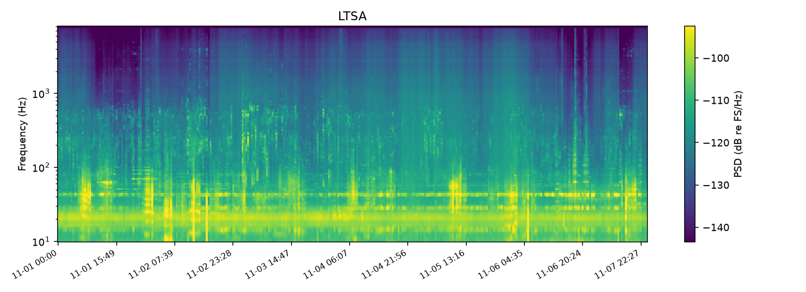

# 深海聲景分析報告（中文完整版）

MBARI MARS 海底水聽器（Monterey Bay，水深 890 m）
資料期間：2018-07 ～ 2019-06（全年），以及 2018-11-01 ～ 11-07（第一週，細看）

> 這份報告記錄整個專案的分析過程與發現。英文精簡版在 [README](../README.md)。
> 所有數字都可以用 README「Quick start」的指令重現。

---

## 0. 一頁摘要

| # | 發現 | 證據 |
|---|---|---|
| 1 | **鯨魚叫聲有明確的季節**：長須鯨 11 月最強、藍鯨 10–11 月、座頭鯨 10–11 月；春夏幾乎沒有 | 全年每月中位數；10–11 月有 37–38% 的分鐘屬於「鯨歌群」，3–8 月只有 0.5–3% |
| 2 | **原始聲景最大的變化來源是「風」，不是生物** | 1–8 kHz 噪音和 NOAA 浮標風速的相關：一週 r = 0.84、全年 r = 0.86 |
| 3 | **改用「相對特徵」後，分群不再被天氣左右** | 分群與風速的關聯 η²：0.49 → 0.025；silhouette：0.27 → 0.52 |
| 4 | **程式自己找到一個地震** | 第一週最大異常值 = USGS 記錄的 M3.3 地震（78 km 外），抵達時間吻合 |
| 5 | **我們的特徵和 MBARI 官方的鯨魚叫聲指數一致** | 同樣 2,189 分鐘：每月相關 長須鯨 r = 0.95、藍鯨 r = 0.91；「鯨歌季」群的官方指數最高 |
| 6 | **資料品質問題都已處理** | 補零的錄音空白、缺少的日期、網路中斷造成的資料遺失、7 個疑似儀器瞬態 |

---

## 1. 資料與方法

| 項目 | 內容 |
|---|---|
| 來源 | MBARI Pacific Sound，`s3://pacific-sound-16khz/`（AWS 公開資料，免帳號） |
| 檔案（實測） | 每天一個 WAV，約 4.15 GB，24 小時、單聲道、16 kHz、24-bit PCM |
| 讀取方式 | 只用 byte-range 讀需要的那一分鐘（約 3 MB、0.2 秒），不下載整個檔案 |
| 第一週 | 每天 48 分鐘（每 30 分鐘 1 分鐘），共 336 → 有效 314 |
| 全年 | 2018-07 ～ 2019-06，每 4 天取 1 天、每小時 1 分鐘，共 95 天 → 有效 92 天、2,189 分鐘 |
| 特徵 | 16 個：頻帶能量、鯨魚頻帶「突出量」(excess)、頻譜形狀、一分鐘內的變異度、峰度 |
| 分群 | 標準化 →（可選）縮尾 → PCA（保留 95% 變異）→ K-Means，k 用 silhouette 自動選 |
| 外部驗證 | NOAA 浮標 46042 逐時風速、USGS 地震目錄、MBARI 水聽器校正檔 |

**幾個名詞**
- **LTSA**（long-term spectral average）：把每分鐘的平均頻譜沿時間排開，一張圖看完整段時間。
- **excess**（突出量）：某個頻帶比左右鄰近頻帶高出幾 dB。鯨魚叫聲是窄頻帶，會「突出」；風、船是寬頻噪音，會把整片一起抬高，所以不會突出。
- **silhouette**：衡量群與群分得多開，−1 到 1，越高越好。
- **η²**：風速的變異有多少比例可以用「屬於哪一群」解釋。0 = 分群跟天氣無關，1 = 分群完全就是天氣。

---

## 2. 第一次跑真實資料時修正的問題

### 2.1 錄音空白（補零）
第一次跑在分群步驟當掉：`ValueError: Input X contains infinity`。

**原因**：MBARI 在錄音中斷的時段用「全 0」補齊。全 0 取 log 會變成 −∞，使 `flatness_db` 變成 inf、`centroid`、`kurtosis` 變成 NaN。

| 日期 | 空白時段 (UTC) | 受影響視窗 |
|---|---|---|
| 2018-11-02 | 01:01 附近 | 1 個（100% 為 0） |
| 2018-11-07 | 06:07 ～ 15:49（約 10 小時） | 20 個（100% 為 0） |
| 2018-11-07 | 17:51 附近 | 1 個（**只有 2% 為 0**） |

最後一個最危險：它**不會讓程式當掉**，卻會默默扭曲特徵，修正前會被當成正常資料使用。

**修正**：超過 1% 樣本剛好為 0 的視窗判定為空白並跳過（真實 24-bit 水聽器訊號幾乎不可能剛好是 0）；分群前再檢查一次，若仍有非有限值就丟掉並記在 `summary.json`。

### 2.2 缺少的日期
全年資料中 2019-04-05、04-09、06-25 三天在 MBARI 檔案庫裡不存在。原本程式遇到會整個中止，現在改成記錄 warning 並跳過，長時間的分析不會因為一天缺資料而白跑。

### 2.3 網路中斷（第二輪才發現）
重算全年時，S3 連線斷了一次，整個計算中止。更嚴重的是重試時：2019-03-01 的 24 分鐘裡有 19 分鐘
讀取失敗，卻被「單一分鐘出錯就跳過」的機制**一筆一筆默默丟掉**，那天只存了 5 分鐘，表面上完全看不出問題。
是因為總數從 2,189 變成 2,170，我才追查到這裡。

修正：
- 讀到的長度不足（連線中斷的跡象）→ 直接報錯，不再把不完整的資料往下傳。
- 某分鐘出錯但**不是**錄音空白 → 視為可能的網路問題，整天重試（最多 3 次，間隔遞增）。
- 空的視窗不再被誤判為「錄音空白」（這是測試抓到的另一個漏洞）。
- 舊版程式留下的快取如果缺少新欄位，會自動重算。

修正後重跑，全年回到完整的 2,189 分鐘，分群結果和原本完全相同（silhouette 0.5206）。

### 2.4 效率
原本每找一天的檔案都會把整個月份重新列一次（每次約 13 秒），改成每個月只列一次。

---

## 3. 第一週：整體聲景

- **15–25 Hz 幾乎不間斷的亮帶**：長須鯨 20 Hz 脈衝的「合唱」（很多隻、遠近疊加）。`fin_excess` 中位數 4.6 dB，69% 的分鐘超過 3 dB。
- **約 45 Hz 斷續的細線**：東北太平洋藍鯨 B call 的基頻，11-05、11-06 最強。
- **由下往上的垂直亮條**：船隻經過。
- **1 kHz 以上背景隨天數變亮變暗**：11-03 ～ 11-05 比 11-01 亮約 12 dB → 第 4 節證實是風。

---

## 4. 驗證一：預設分群其實是在分「風大／風小」

預設（16 個特徵全用）自動選到 k = 2，silhouette 0.34。兩群的差別集中在高頻：

| 群 | 視窗數 | 1–8 kHz | flatness | 浮標風速中位數 |
|---|---|---|---|---|
| 0 | 85 | −99.0 dB | −16.9 dB | **5.0 m/s** |
| 1 | 229 | −91.6 dB | −8.3 dB | **9.3 m/s** |

把每一分鐘對上 NOAA 浮標 46042（Monterey Bay）最接近時間的逐時風速：

- 1–8 kHz 噪音 vs 風速：**Spearman r = 0.84**（n = 314）；全年 **r = 0.86**（n = 2,171）。
- 100 Hz 以上的能量與頻譜形狀都跟著風變（|r| = 0.50–0.84）。
- 低頻能量、excess 特徵、峰度幾乎不受風影響（|r| < 0.12）。
- 200–2000 Hz 變異度在風大時略降（r = −0.36），合理解釋是風噪把短促叫聲蓋掉了。

**結論**：這是海洋聲學的已知物理現象（碎浪主導 1 kHz 以上的背景噪音）。預設分群抓到的是天氣，不是動物。這不是錯，但如果目的是找鯨魚，就需要改方法。

---

## 5. 改善：「相對特徵」讓分群找到動物

**想法**：風會把整片頻譜一起抬高。如果只用「跟自己比」的特徵（某頻帶比鄰近頻帶高多少、同一分鐘內起伏多大、波形多尖），整體抬高就會互相抵消。

相對特徵（6 個）：`fin_excess`、`blue_excess`、`var_10_100`、`var_200_2k`、`p90_minus_med_200_2k`、`kurtosis`。

另外加上**縮尾 (winsorize)**：每個特徵截在第 1 到第 99 百分位之間。原因是一開始有一個峰度 167 的視窗自己佔了一整群；縮尾之後不會再發生。

| 資料 | 特徵 | k（silhouette） | 分群與風速的 η² |
|---|---|---|---|
| 11 月那週 | 全部 | 2（0.34） | 0.38 |
| 11 月那週 | 相對 + 縮尾 1% | 4（0.33） | **0.06** |
| 全年 | 全部 | 5（0.27） | 0.49 |
| 全年 | 相對 + 縮尾 1% | 3（**0.52**） | **0.025** |

11 月那週，自動選出的 4 群可以直接從頻譜圖看出是什麼：

| 群 | 分鐘數 | 判讀 | 關鍵數字 |
|---|---|---|---|
| 0 | 185 | 背景（長須鯨合唱 + 風浪） | — |
| 1 | 45 | **藍鯨 B call** | blue_excess 11.6 dB（其他群約 3.9） |
| 2 | 76 | **座頭鯨歌聲** | 200–2000 Hz 變異度 3.7（其他群約 1.3） |
| 3 | 8 | **瞬態脈衝** | 峰度高，頻譜圖上看得到垂直寬頻脈衝 |

全年資料則自動分成 3 群：背景、瞬態、以及**「鯨歌季」群**（長須鯨、藍鯨、座頭鯨指標同時偏高），這一群在 10–11 月佔 37–38%，3–8 月只佔 0.5–3%。

**代價（用合成資料量化過）**：相對特徵能完美分出三種鯨魚，但會把「船」和「背景」併成一群（ARI 0.78，全特徵是 1.0），因為合成資料裡的船主要就是「比較大聲」。所以兩種設定各有用途：
- `all`：監測噪音（船、海況）
- `relative`：找動物

---

## 6. 全年：季節與晝夜

| 月份 | 長須鯨 fin_excess | 藍鯨 blue_excess | 座頭鯨指標 var_200_2k | 1–8 kHz（dB re 1 µPa） |
|---|---|---|---|---|
| 2018-07 | −1.0 | 1.1 | 0.83 | 89.4 |
| 2018-08 | −1.4 | 1.9 | 0.70 | 90.4 |
| 2018-09 | 1.7 | 2.1 | 0.86 | 89.6 |
| 2018-10 | 2.9 | **3.5** | **1.66** | 93.1 |
| 2018-11 | **4.6** | 3.3 | 1.56 | 92.7 |
| 2018-12 | 3.5 | 1.2 | 1.19 | 94.2 |
| 2019-01 | 2.5 | 0.7 | 0.57 | 96.9 |
| 2019-02 | 1.8 | 0.6 | 0.50 | **98.6** |
| 2019-03 | 1.0 | 0.9 | 0.64 | 91.1 |
| 2019-04 | 0.8 | 0.5 | 0.58 | 92.9 |
| 2019-05 | 0.6 | 0.8 | 0.55 | 93.1 |
| 2019-06 | −0.4 | 0.5 | 0.73 | 91.7 |

**解讀**
- 三種鯨魚都是**秋季上升、11 月前後最高、1 月後消退**，夏季最低。這符合這個海域的已知季節（長須鯨秋冬、藍鯨夏末到秋季）。
- 風浪噪音則在 **1–2 月冬季暴風季**最高，和生物訊號的季節不同步。這也是為什麼必須把兩者分開。
- 全年 LTSA（README 最上方）用肉眼就看得到：20 Hz 長須鯨亮帶出現在 9 月到 1 月，45 Hz 藍鯨線出現在 8 月到 11 月。

**晝夜**（太平洋時間，已處理夏令時間）：10–12 月座頭鯨指標夜間比白天高 0.6–0.95 dB。效果很小，而且每月只有約 8 天資料，所以只當作「線索」，不當成結論。

---

## 7. 驗證二：程式自己找到一個地震

第一週最突出的異常值：**2018-11-02 16:19:44 UTC**。10–100 Hz 達 −55 dB re FS，比中位數高約 30 dB；PC1 = 17，其他點都在 8 以下。

頻譜圖上，低頻能量在開始約 3 秒時突然出現，約 40 秒內慢慢衰減，而上方的座頭鯨歌聲沒有中斷。船是逐漸變大、逐漸變小、持續幾十分鐘，形狀完全不同。

查 USGS 地震目錄：**16:19:30.5 UTC，M3.31，加州 Tres Pinos 南方 12 km，深 6.5 km**，距 MARS 約 78 km。能量在發震後約 17 秒抵達，落在這個距離的 P 波（約 13 秒）和 S 波（約 22 秒）抵達時間之間。

這是「非監督方法發現異常 → 用獨立外部資料證實」的完整案例。

---

## 8. 驗證三：和 MBARI 官方的鯨魚叫聲指數比較

MBARI 的官方教學（作者 John Ryan）定義了兩個**叫聲指數 (call index, CI)**：

| 指數 | 訊號頻率 | 背景頻率 | 公式 |
|---|---|---|---|
| 長須鯨 | 20、21 Hz | 12、34 Hz | 訊號頻率的平均頻譜位準 ÷ 背景頻率的平均頻譜位準 |
| 藍鯨 B call | 43、44 Hz | 37、50 Hz | 同上 |

（60 秒 Welch 頻譜、1 Hz 解析度、校正到 dB re 1 µPa²/Hz；CI = 1 代表沒有訊號。）
MBARI 也把缺資料超過 1% 的分鐘排除，和我們修正錄音空白時用的門檻**剛好相同**。

**做法**：MBARI 沒有公開算好的指數數值，所以我在同樣的 2,189 分鐘上，完全照官方程式碼計算指數
（有測試逐行重現官方程式碼來比對），再拿去和我們自己設計的 `fin_excess`、`blue_excess` 比較。
另外確認：用我們的 16 kHz 資料算出的指數，和用 MBARI 自己的 2 kHz 資料算出的，差距在 0.0006 以內。

| 一致程度（Spearman r） | 長須鯨 | 藍鯨 |
|---|---|---|
| 每月（12 個月） | **0.95** | **0.91** |
| 每分鐘，全年 | 0.81 | 0.66 |
| 每分鐘，該物種的季節內（長須鯨 9–1 月、藍鯨 8–11 月） | 0.76 | **0.82** |
| 每分鐘，季節外 | 0.73 | 0.46 |

**為什麼藍鯨全年只有 0.66？** 藍鯨不在的月份，官方指數本身幾乎不動（標準差 0.023，季節內是 0.062），
兩個指標都只是在量雜訊，當然不會一致；季節內就高度一致（0.82）。

### 8.1 追查：為什麼 1–5 月我們的長須鯨指標下降得比官方慢？

**做法**：重新抓全部 2,189 分鐘的**精確 1 Hz 頻譜**（`scripts/low_freq_spectra.py`），
然後做幾個「一次只改一個設計選擇」的指數版本（`scripts/fin_index_decomposition.py`），
都縮放成「夏季 = 0、11 月 = 1」來比形狀。1–5 月的平均值：官方 0.25、我們的 0.45。

| 只改一個地方 | 1–5 月 | 結論 |
|---|---|---|
| 官方指數改成 dB 相減，而不是相除 | 0.25 | 沒影響 |
| 用我們的寬頻帶 17–25 Hz，背景用官方的 12、34 Hz | 0.26 | **頻帶寬度沒影響** |
| 用官方的 20–21 Hz，背景用我們的 11–15、28–34 Hz | 0.40 | **差距主要來自這裡** |

我原本從頻譜圖猜是「春季峰變寬」（春季的峰確實變平，銳利度從 11 月的 3.1 dB 降到 4 月的 0），
但分解後發現**真正的原因是背景頻率的選擇**：

- 我們的背景頻帶 11–15 Hz 和 28–34 Hz，剛好包含**藍鯨 B call 的基頻（約 14 Hz）和第二諧波（約 28 Hz）**。
- 證據 1：8–11 月，28 Hz 的能量和官方藍鯨指數高度相關（r = +0.71）。
- 證據 2：8–11 月藍鯨叫得最強的 20% 分鐘，我們的 `fin_excess` 反而比最弱的 20% **低 0.68 dB**；
  但官方長須鯨指數顯示那時長須鯨其實更活躍（1.079 vs 1.030）。
- 也就是說：秋天藍鯨的叫聲把我們的「背景」抬高，壓低了長須鯨的數值；春天藍鯨走了，汙染消失，
  所以看起來像「下降得慢」。不是長須鯨待得久，是秋天的數值被壓低了。官方選 12、34 Hz 正好避開了這兩個諧波。

**修正方案（已離線驗證，尚未套用到流程）**：背景改成 **11–13 Hz 和 33–36 Hz**，避開藍鯨諧波。

| | 原本 | 修正後 |
|---|---|---|
| 每分鐘和官方長須鯨指數的相關 | 0.81 | **0.93** |
| 長須鯨季節內每分鐘 | 0.77 | **0.96** |
| 每月 | 0.95 | **0.99** |
| 1–5 月相對強度（官方 0.25） | 0.45 | **0.28** |
| 藍鯨強 vs 弱的分鐘差 | −0.68 dB（被壓低） | **+3.06 dB** |
| 相對特徵分群 k / silhouette / 風 η² | 3 / 0.521 / 0.025 | 3 / 0.513 / 0.020 |

分群結構幾乎不變，所以先前的主要結論都不受影響。目前報告裡其他數字仍來自原本的定義；
正式套用需要重新抽取特徵、更新所有數字。

**用官方指數檢驗群的名稱**（指數沒有參與分群，所以這是獨立的檢驗）：

| 群 | 分鐘數 | 長須鯨 CI 中位數 | 藍鯨 CI 中位數 |
|---|---|---|---|
| 全年「鯨歌季」群 | 257 | **1.087** | **1.040** |
| 全年 背景群 | 1,902 | 1.017 | 1.011 |
| 全年 瞬態群 | 30 | 1.000 | 1.005 |
| 11 月「藍鯨 B call」群 | 45 | 1.126 | **1.187** |
| 11 月 其他三群 | 8–185 | 1.108–1.134 | 1.071–1.120 |

原本只靠看頻譜圖命名的「藍鯨群」，在官方藍鯨指數上確實是那週最高的。座頭鯨 MBARI 沒有類似指數，
所以座頭鯨群的名稱仍然只靠頻譜圖（以及之後你在儀表板上實際聆聽）。

---

## 9. 資料品質：7 個疑似儀器瞬態

全年資料（全特徵）有一群只有 7 分鐘：峰度 600–2000，10–100 Hz 最高 155 dB re 1 µPa。

- 7 個時間點都對不到 USGS 地震（M ≥ 2、400 km 內）。
- 檢查其中 3 個的原始波形：都是**單一、約 30 毫秒、平滑、比背景大 30–100 倍的脈衝**，前後都平靜。
- 比較像有東西碰到水聽器（機械接觸）或電子瞬態，但光看音訊無法確定原因，所以標為「疑似」。

建議：加一個品質旗標（峰度 > 100），並向 MBARI 詢問這些日期。

---

## 10. 校正：從 dB re FS 到 dB re 1 µPa

| 項目 | 值 | 來源 |
|---|---|---|
| 水聽器 | Ocean Sonics icListen HF（SN 1689），部署 2017-06-13 ～ 2024-08-07 | `MBARI_MARS_Hydrophone_Deployment02.json`（每個 WAV 檔頭都指向它） |
| 靈敏度 | −177.9 dB re V/µPa（250 Hz）、−176.8（10 kHz），2017-02-02 實驗室校正 | 同上 |
| 樣本轉電壓 | × 3 | MBARI 官方教學 notebook |
| 校正常數 | 20·log10(3) + 177.9 = **+187.44 dB** | 計算 |

- 用 250 Hz 的值（MBARI 對 250 Hz 以下也用這個值，鯨魚頻帶都在這裡）。整個頻帶的響應差 1.1 dB，所以誤差約 ±0.55 dB。
- `mbari --calibrated` 會自動套用，並拒絕部署期間以外的日期。
- 已有測試確認：我們算出的值和 MBARI 官方做法相差 < 0.01 dB。
- 相對特徵（excess、變異度、形狀）不受校正影響，所以分群結果不變。

---

## 11. 原本的限制，各怎麼處理

| 原本的限制 | 處理方式 | 狀態 |
|---|---|---|
| 只有一週，看不出季節 | 擴大到全年（每 4 天、每小時 1 分鐘） | ✅ 完成，季節模式清楚 |
| 「高頻 = 風浪」未驗證 | 對上 NOAA 浮標風速 | ✅ r = 0.84 / 0.86 |
| 分群被天氣主導 | 相對特徵 + 縮尾 | ✅ η² 0.49 → 0.025 |
| 長須鯨指標的背景頻帶含藍鯨諧波 | 已找到原因並離線驗證修正（8.1 節） | ⚠️ 修正尚未套用 |
| 群的名稱只靠看圖 | 儀表板加播放（可 4× / 10× 加速，讓 20 Hz 變成聽得到的 200 Hz）；用 MBARI 官方指數檢驗 | ✅ 長須鯨、藍鯨已有官方指數佐證；座頭鯨**需要你實際聆聽** |
| 未校正 | 用 MBARI 部署檔的靈敏度 | ✅ dB re 1 µPa（±0.55 dB） |
| 取樣不連續 | 這是取捨：每月比例可比較，但短事件會漏 | ⚠️ 未改，需要時可在特定日子加密取樣 |

---

## 12. 下一步建議

1. **聽**：用儀表板「Inspect a window」聽每一群的例子，特別是座頭鯨群。這是目前最需要人做的一步。
2. **正式套用長須鯨指標的修正**（背景改成 11–13、33–36 Hz），重跑並更新所有數字。
3. **監督式學習**：在儀表板標註幾百分鐘，訓練分類器，和非監督分群比較。
4. **延長到多年**（2017-06 ～ 2024-08 同一支水聽器、同一個校正），看年際變化。
5. **頻率相依校正**：用部署檔的完整頻率響應取代單一常數。

---

## 資料來源
- MBARI Pacific Sound（AWS Open Data）：<https://registry.opendata.aws/pacific-sound/>，引用 <https://doi.org/10.1109/OCEANS.2016.7761363>
- MBARI 16 kHz 教學：<https://docs.mbari.org/pacific-sound/notebooks/data/PacificSound16kHz/>
- 水聽器部署檔：<https://bitbucket.org/mbari/pacific-sound/src/master/MBARI_MARS_Hydrophone_Deployment02.json>
- NOAA NDBC 46042 歷史資料：<https://www.ndbc.noaa.gov/station_page.php?station=46042>
- USGS 地震目錄：<https://earthquake.usgs.gov/fdsnws/event/1/>
- MBARI 叫聲指數教學（John Ryan）：<https://github.com/mbari-org/pacific-sound-notebooks>（長須鯨、藍鯨 B call 兩個 notebook）
